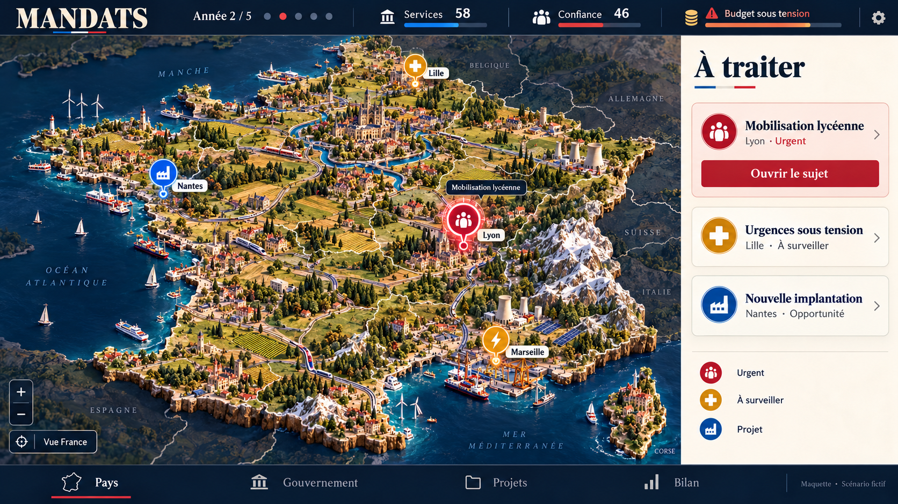

# MANDATS : référence du diorama 3D

## Références visuelles

Le 8 octobre 2026, le propriétaire a explicitement confirmé cette maquette avec la consigne : « C’est elle donc tu rapproches systématiquement de ça quand tu penses avoir terminé ».

La [référence principale](mandats-diorama/reference-ordinateur.png) est la première carte sur ordinateur : en-tête MANDATS bleu nuit, panneau ivoire « À traiter », mobilisation lycéenne à Lyon, marqueurs à Lille, Nantes et Marseille, navigation en bas. La France est une miniature riche en architectures, reliefs, végétation et activités, entourée d'une mer bleu profond. La lumière est chaude et les titres utilisent une typographie à empattements.

Le fichier conservé reproduit cette maquette originale. Il remplace la proposition ultérieure charbon et menthe qui avait été désignée à tort comme référence principale. La [précédente étude mobile](mandats-diorama/reference-mobile.png) reste un complément pour la concision des sujets et des réponses ; son style ne remplace pas la direction artistique de l'image confirmée. Les adaptations mobiles doivent conserver cette direction avec une lecture simple.

La maquette est une référence artistique. Les captures de validation doivent provenir du navigateur exécutant le jeu. Le code, le moteur de jeu et les contrôles HTML fournissent les interactions et les conséquences.

Les exigences ultérieures du propriétaire restent applicables : lecture simple, peu d'informations simultanées, choix direct, aucun cadratin, aucune flèche ni aucun chevron. Les jauges, onglets et flèches présents dans certaines maquettes ne constituent donc pas des éléments à reproduire systématiquement.

## Critères observables

| Aspect | Référence à retrouver dans le rendu réel |
| --- | --- |
| Composition | La France constitue le sujet principal. Son relief reste lisible, les côtes sont reconnaissables et la Corse reste visible au cadrage initial. Le cadrage s'adapte à la surface disponible. |
| Profondeur | L'inclinaison révèle les façades, les reliefs et les vallées. Les bâtiments et arbres sont ancrés au sol par un éclairage et des ombres cohérents. Une inspection change réellement le point de vue dans une scène 3D. |
| Territoire | Forêts groupées, champs, tissus urbains, fleuves, routes et littoral forment un ensemble. Leur répartition évite un semis uniforme de primitives isolées. Les reliefs comportent des crêtes et des variations de pente. |
| Villes | Les agglomérations présentent plusieurs silhouettes, des quartiers, des rues et des repères architecturaux. Un petit village identique posé sur une dalle ne suffit pas à représenter chaque métropole. |
| Matières | Couleurs nuancées et détails perceptibles sur le sol, la pierre, les toitures et l'eau. Les surfaces conservent une unité artistique avec la lumière chaude, la végétation et les tons marins des références. |
| Interface | L'en-tête bleu nuit, le panneau ivoire, les titres à empattements et les urgences rouges retrouvent la direction de la maquette confirmée. La composition garde la carte dominante et les sujets immédiatement repérables. |
| Eau et environnement | La mer présente des variations lisibles autour des côtes. L'environnement contribue à la composition, avec des territoires voisins discrets plutôt qu'une grande surface uniforme. |
| Netteté | Le framebuffer conserve au moins la résolution CSS dans le parcours de référence, y compris sur écran à forte densité et après redimensionnement. Les étiquettes restent des contrôles HTML lisibles et accessibles. |
| Lecture | Un sujet ouvert affiche son problème et des réponses distinctes avec un sacrifice concret. Les détails restent consultables à la demande. La carte accompagne la décision sans repousser les choix plusieurs écrans plus bas. |
| Activité | Les mobilisations, projets et livraisons apparaissent à partir des décisions réellement enregistrées. Leur lecture reste possible sans animation. |

## Comparaison obligatoire avant de conclure

Pour chaque itération visuelle :

1. Conserver une capture réelle du jeu sur ordinateur, avec le viewport, le navigateur, la version et les entrées de partie permettant de la reproduire.
2. Présenter cette capture à côté de la maquette principale confirmée. Comparer la composition complète, puis des vues rapprochées des villes, reliefs, forêts, côtes, eau et matières.
3. Examiner également les captures à 390 et 320 pixels et un sujet ouvert : l'adaptation doit préserver la direction artistique, la lisibilité et l'accès aux réponses.
4. Documenter les écarts visibles selon les critères ci-dessus. Tant que le rendu reste sensiblement éloigné de la maquette, poursuivre le travail ou annoncer explicitement une étape intermédiaire. Le travail visuel ne peut pas être présenté comme terminé.

Un succès de compilation ou la seule présence d'un contexte WebGL ne valide pas la fidélité artistique. La passe actuelle et son verdict visuel sont documentés ci-dessous, séparément des preuves historiques.

L'[atelier de modèles existants du 9 octobre](mandats-diorama/library-study-20261009/README.md) conserve une maison issue du kit Quaternius 2025 et un rocher Poly Haven, leurs sources CC0 vérifiées, leurs recettes Blender reproductibles et leurs imports expérimentaux dans Babylon. Ces substitutions de test ne modifient pas la source 37 ; la carte complète reste non conforme et aucune adoption en production n'est déclarée.

## Passe 39 du 11 octobre 2026, en cours

La [comparaison native 39](mandats-diorama/comparaison-39.html) reprend la scène
entière : proportions des maisons et monuments, reliefs, sillons, végétation,
littoral, ports, centrales, convois et mer. Les captures de production à
1 672 × 941, sans substitution ou état injecté, montrent 774 maisons et le
terrain précalculé réellement chargé. Les grandes faces alpines, la finesse
des villages et la richesse du littoral restent en deçà de la maquette.
**La conformité artistique reste non atteinte ; la PR demeure en brouillon.**

Le générateur canonique exporte désormais [17 maillages de terrain](../tools/mandats-assets/TERRAIN.md)
pour éviter de refaire leur construction dans le navigateur. Les 300 057
triangles sont conservés ; 112 273 sommets sans indice sont retirés. La
recoloration liée aux arbres et aux cultures demeure dans la scène. Le build
contrôle les empreintes des sources et le précache inclut l'archive locale.
Après correction du décodage HTTP, le parcours haute densité passe avec les
délais originaux, une vraie décision et une reprise. La [suite 3D complète](mandats-diorama/screens-39/rework-report.json)
passe 23 parcours sur desktop, 390 px, 320 px et WebKit, avec 9 exclusions
prévues par sa configuration et aucun échec. Elle couvre le mandat complet,
la reprise, le hors connexion, les mobilisations et les replis WebGL.
Le [relevé de production](mandats-diorama/screens-39/scene-diagnostics.json)
confirme les uniformes de côte sur le GPU, sans erreur WebGL, et aucune
intersection entre canopées et les douze monuments contrôlés. L’[audit des
emprises portuaires](mandats-diorama/screens-39/harbour-footprint-audit.json)
ne relève aucun chevauchement entre les cinq ports et leurs 26 bateaux.
Ces contrôles sont limités aux objets et polygones relevés ; ils ne démontrent
pas une absence générale d’intersection ni la conformité artistique.
La [suite sociale complète](mandats-diorama/screens-39/social-report.json)
passe 13 parcours avec 3 exclusions configurées, dont les quatre imports causaux
qui échouaient en CI au commit précédent. Le [contrôle WebKit ciblé](mandats-diorama/screens-39/story-webkit-focused-report.json)
du démarrage national v12, de la sélection sauvegardée et de sa reprise passe
également au délai original de 90 secondes ; il échouait aussi au commit précédent.
Ce contrôle ciblé ne remplace pas la suite narrative complète. Les autres suites
de compatibilité restent à lancer sur le rendu finalement retenu.

## Passe 38 du 11 octobre 2026

La [comparaison native 38](mandats-diorama/comparaison-38.html) reprend cet atelier et intègre la maison CC0 finie dans le kit de la branche, aux deux adresses existantes à Besançon. La géométrie détaillée conserve 1 481 triangles. Le niveau distant est reconstruit à 695 triangles : la planche Babylon a révélé des trous dans les façades du candidat précédent à 287 triangles. Chaque niveau possède désormais une primitive et son atlas, de 512 ou 128 pixels. Le chargeur raccorde ces deux surfaces malgré leurs matières différentes. Les 70 autres racines actives du kit restent identiques.

La [recette Blender](../tools/mandats-library-assets/HOUSE-ATLAS.md), le modèle éditable et les exports sont conservés. Une seconde génération et une composition depuis le kit original produisent les mêmes GLB et métadonnées, octet par octet. Le [contrôle physique ciblé](mandats-diorama/screens-38/placement-and-lod.json), distinct du jeu, vérifie les deux pieds et le changement réel de niveau avec la caméra, avec les constructeurs et modèles distribués. Quatre vues natives du build final, sans substitution réseau ni injection d'état, documentent la carte et ses matières.

**La carte complète reste non conforme à la maquette.** Cette intégration ne corrige pas la cathédrale trop massive, les reliefs anguleux, la campagne ou le contexte répétitif. Les petits raccords de toiture et le modèle distant demandent encore de la finesse. Les [résultats des parcours et leurs limites](mandats-diorama/screens-38/validation.md) distinguent la vérification technique de cette étape du travail artistique restant. La PR reste en brouillon.

## Passe 37 capturée le 9 octobre 2026

La [comparaison native 37](mandats-diorama/comparaison-37.html) conserve la référence intacte et cinq vues réellement examinées par root. Les petites fractures des roches et des côtes, les parcelles à plusieurs tons et la pierre sélective de la cathédrale sont appliquées. **Le verdict reste non conforme à la maquette** : grands fronts montagneux continus et anguleux, arrière-plan de plaques répétées et de houppiers volumineux, campagne moins fine et moins dense, cathédrale trop massive. Les ports et la mer restent moins riches que dans la référence. Cette passe ne constitue pas une reproduction à l'identique.

Le [build complet 37](mandats-diorama/screens-37/build.json), avec son [reçu réel](mandats-diorama/screens-37/fullcheck-receipt.json) et son [journal](mandats-diorama/screens-37/fullcheck-command.log), passe 1 082 tests sur 236 entrées verrouillées. Les [sept vues natives](mandats-diorama/screens-37/verification.json) sont capturées sous Chromium 151, à 1 672 × 941, DPR 1, mouvement réduit, graine 0 et zéro décision ; aucune erreur JavaScript, HTTP, requête ou console n'est enregistrée. Les [neuf PNG de matières](mandats-diorama/screens-37/png-browser-proof.json) reçues puis décodées dans le navigateur correspondent aux fichiers archivés et aux pixels RGBA attendus. Ce contrôle ne mesure pas un readback GPU de la scène ni une cadence FPS.

L'[audit physique ciblé 37](mandats-diorama/screens-37/physical-summary-final.json) et son [reçu réel](mandats-diorama/screens-37/physical-receipt.json) passent avec les gardes existantes : les 781 maisons définies et leurs contacts au sol, les 2 612 arbres en France / 23 894 points de pied, les 2 561 arbres du contexte / 20 709 points, les 305 rochers / 1 830 points, le lycée, les places publiques, les foules et les réservations de projets. Le contrôle côtier dense conserve 179 172 sondages et les 48 + 25 coordonnées historiques, sans manque de sol intérieur. Les [métadonnées minérales](mandats-diorama/screens-37/mineral-fractures-diagnostic.json) enregistrent 168 coordonnées abaissées au plus de 0,030492 unité, sans ajout de sommets ou de triangles. Les [métadonnées agricoles et côtières](mandats-diorama/screens-37/field-coast-diagnostic.json) enregistrent huit parcelles traitées, 86 triangles agricoles ajoutés, trois triangles de limites internes et 388 facettes côtières fracturées. Ces relevés distincts ne constituent pas une garantie exhaustive ou artistique.

Les [deux contrôles E2E ciblés originaux 37](mandats-diorama/screens-37/focused-summary.json), avec leur [reçu réellement consommé](mandats-diorama/screens-37/focused-receipt.json), passent. Le [parcours desktop](mandats-diorama/screens-37/focused-models-result.json) conserve une décision pendant le chargement retardé des GLB, rejoint le renderer au délai original de 15 secondes après leur libération, conserve la sauvegarde en repli HTTP 503 puis la reprend après rechargement. Le [parcours WebKit DPR 2](mandats-diorama/screens-37/focused-webkit-density-result.json) passe le redimensionnement et Reprendre ; ses [relevés de résolution après reprise](mandats-diorama/screens-37/focused-webkit-density-carte-reprise-dpr-2-resolution.json) sont conservés. Les délais, assertions et seuils n'ont pas été assouplis. Ces résultats 37 ne remplacent pas l'échec original 36 conservé ci-dessous.

**La [suite rework complète 37](mandats-diorama/screens-37/full-rework-result.json) échoue : 20 tests réussis, trois échecs et neuf omissions prévues.** Son [reçu réellement consommé](mandats-diorama/screens-37/full-browser-receipt.json), le [rapport Playwright](mandats-diorama/screens-37/full-rework-report.json) et le [journal de commande](mandats-diorama/screens-37/full-rework-command.log) sont conservés. Les reprises après redimensionnement en DPR2 sur compact et WebKit échouent à la ligne 224 : `data-renderer` reste `loading` au délai original de 15 000 ms après Reprendre. Les [contextes compact](mandats-diorama/screens-37/full-rework-compact-density-error-context.md) et [WebKit](mandats-diorama/screens-37/full-rework-webkit-density-error-context.md) documentent ces échecs, malgré les pixels de carte présents dans leurs captures. Le parcours complet à 320 pixels atteint la fin du mandat et commence une autre trajectoire, puis dépasse son délai total original de 180 000 ms ; son [contexte d'échec](mandats-diorama/screens-37/full-rework-compact-mandate-error-context.md) est conservé. Ces trois échecs restent distincts des deux contrôles ciblés réussis ci-dessus. Le [relevé complet](mandats-diorama/screens-37/full-browser-summary.json) confirme l'arrêt avant social, header et test:mandats, **non exécutés sur 37**. Les trois traces restent dans le dossier externe de preuve, avec leurs [chemins exacts, tailles et SHA](mandats-diorama/screens-37/full-rework-trace-provenance.json).

Les captures réelles de mobilisation à [390 pixels](mandats-diorama/screens-37/full-rework-390-mobilisation-active.png), [320 pixels](mandats-diorama/screens-37/full-rework-320-mobilisation-active.png) et sur [WebKit](mandats-diorama/screens-37/full-rework-webkit-mobilisation-active.png) conservent la carte au-dessus du panneau ivoire et le sujet urgent issu de la décision sauvegardée. La [lecture des captures](mandats-diorama/screens-37/browser-artifact-review.json) distingue ces compositions mobiles des échecs de reprise ; les images complètes dépassent la hauteur du viewport. Le [parcours hors connexion mobile](mandats-diorama/screens-37/full-rework-390-hors-connexion-3d.json) réussit dans cette même suite, avec une capture réelle conservée. Ces réussites partielles ne valident pas toute la suite ou la fidélité à la référence.

Une [sonde de profil compact séparée](mandats-diorama/screens-37/compact-profile/summary.json), avec son [reçu réel](mandats-diorama/screens-37/compact-profile/receipt.json), réussit la reprise dans cette exécution instrumentée. Le clic Reprendre dure 7,852 s avant le début de l'attente du renderer ; cette attente termine ensuite en 10,462 s au délai original de 15 secondes. Aucune continuation après échec n'est utilisée. Les 236 entrées, les 249 fichiers archivés et les tests originaux restent identiques. Le [profil décodé](mandats-diorama/screens-37/compact-profile/decoded-profile.json) conserve les phases et coûts observés, avec sa [provenance](mandats-diorama/screens-37/compact-profile/provenance.json). **Ce diagnostic ne remplace aucun des trois échecs E2E originaux 37.** Le profilage peut modifier les temps et le placement des phases ; ces mesures ne démontrent pas une amélioration du démarrage ou une cadence GPU.

L'accueil sans partie adoptée utilise une illustration issue du véritable rendu 36, uniquement après le chargement réussi de son image. La carte active reste une scène Babylon.js. Le [contrôle du fichier émis et des dépendances hors connexion](mandats-diorama/screens-37/welcome-static-asset-proof.json) vérifie cette image et sa présence parmi les 147 ressources du lot généré ; cet outil statique n'exécute pas l'installation hors connexion ou un parcours navigateur de l'accueil.

Un [contrôle navigateur complémentaire de l'accueil](mandats-diorama/screens-37/welcome/welcome37-result.json), avec son [reçu réel](mandats-diorama/screens-37/welcome/receipt.json), passe ses six cas : accueil ordinateur, 390 pixels, 320 pixels, repli après HTTP 503 de l'image, reprise d'une sauvegarde créée dans le navigateur et accès direct à la sauvegarde initiale par le lien `#challenge` pris en charge. Les images de [390 pixels](mandats-diorama/screens-37/welcome/02-mobile390-welcome.png), [320 pixels](mandats-diorama/screens-37/welcome/03-compact320-welcome.png) et du [repli SVG](mandats-diorama/screens-37/welcome/04-mobile390-png503-svg-after-503.png) sont conservées. Les [huit PNG effectivement examinées par root](mandats-diorama/screens-37/welcome/root-image-review.json) montrent l'illustration à l'accueil, puis la vraie carte après Commencer ou Reprendre. L'image est masquée après adoption ; l'accès direct vérifie son absence et l'absence de requête vers ce fichier. La capture directe coupe partiellement le pied de page et ne valide pas toute la composition. Les attentes complémentaires restent bornées à 120 secondes pour le renderer et 45 secondes pour `renderPending=false` ; **elles ne remplacent pas les attentes originales de 15 secondes ni les échecs de la suite complète**. Le verdict artistique reste non conforme. Aucune fidélité finale ni livraison terminée n'est revendiquée.

## Passe 36 capturée le 9 octobre 2026

La [comparaison native 36](mandats-diorama/comparaison-36.html) présente la référence intacte et cinq vues effectivement examinées par root. Les voiles blanches, les rues plus claires, les onze groupes agricoles et les parcelles plus fines améliorent le rendu. **Le verdict reste non conforme à la maquette** : grandes falaises et fronts montagneux continus, contexte massif, plaines encore clairsemées et cathédrale grise trop massive. Cette passe ne constitue pas une reproduction à l'identique.

Le [build complet 36](mandats-diorama/screens-36/build.json) passe réellement 1 082 tests sur 233 entrées verrouillées ; le lot hors connexion conserve 146 ressources. Les [sept vues natives](mandats-diorama/screens-36/verification.json) terminent sans erreur JavaScript, HTTP, requête ou console. Les [neuf PNG](mandats-diorama/screens-36/png-browser-proof.json) reçues et décodées dans le navigateur ont les dimensions et pixels RGBA attendus. Ce contrôle ne mesure pas un readback GPU des matières de la scène ni une cadence FPS.

L'[audit physique ciblé 36](mandats-diorama/screens-36/physical-summary-final.json) et son [reçu réel](mandats-diorama/screens-36/physical-receipt.json) passent avec les gardes existantes : les 781 maisons définies sont construites, dont 44 ajouts décoratifs et les 737 anciennes adresses conservées ; leurs fondations et contacts avec les triangles de sol passent. Les 2 612 arbres en France / 23 894 points de pied, les 2 561 arbres du contexte / 20 709 points, les 305 rochers / 1 830 points, le lycée, les places publiques, les foules et les réservations de projets passent les contrôles effectués. Le contrôle côtier dense conserve 179 172 sondages et les 48 + 25 coordonnées historiques, sans manque de sol intérieur. Ces gardes ciblées ne constituent pas une garantie exhaustive ou artistique.

**Le [test desktop original des modèles retenus](mandats-diorama/screens-36/focused-models-result.json) échoue sur 36**, avec son [reçu d'échec réel](mandats-diorama/screens-36/focused-models-receipt.json). Après une décision réellement sauvegardée puis la libération des GLB retardés, sa première attente de renderer échoue à la ligne 521 : `data-renderer` reste `loading` au délai original de 15 000 ms. Le [journal de commande](mandats-diorama/screens-36/focused-models-command.log) et le [rapport Playwright](mandats-diorama/screens-36/focused-models-report.json) sont conservés. Les assertions ultérieures du scénario HTTP 503 et de la reprise après rechargement n'ont donc pas été exécutées. La trace de cet échec reste conservée dans le dossier externe de preuve 36.

Une [sonde de profil séparée](mandats-diorama/screens-36/held-profile-summary.json), avec son [reçu réel](mandats-diorama/screens-36/held-profile-receipt.json), atteint le renderer en 9 226,774 ms au délai de 15 000 ms. Ses 233 entrées et 248 fichiers archivés restent stables. Ce résultat de diagnostic distinct **ne remplace pas l'échec du test original 36 et n'est pas compté comme une réussite E2E**. Il n'exécute pas les assertions ultérieures HTTP 503, reprise sauvegardée et WebKit.

Le [relevé de la session ciblée 36](mandats-diorama/screens-36/focused-summary.json) confirme l'arrêt après ce premier échec. Le groupe WebKit DPR2 prévu ensuite et les quatre suites complètes rework, social, header et test:mandats restent **non exécutés sur 36**. Les réussites ciblées 35 ci-dessous restent historiques et ne valident pas 36. Les délais, assertions et seuils n'ont pas été assouplis ; aucune fidélité finale ni livraison terminée n'est revendiquée.

## Passe 35 capturée le 9 octobre 2026

La [comparaison native 35](mandats-diorama/comparaison-35.html) conserve la référence originale et cinq captures effectivement examinées par root. Les pointes gothiques améliorent la silhouette de la cathédrale, mais **le verdict reste non conforme à la maquette** : voiles encore noires, ombres lourdes, campagnes clairsemées, grands pans anguleux du terrain et du contexte. Les textures et les formes des Alpes et des côtes ne retrouvent pas la finesse de la référence. Cette passe constitue une étape intermédiaire.

Le [build complet](mandats-diorama/screens-35/build.json) passe réellement 1 082 tests sur 231 entrées verrouillées. Les [sept vues natives](mandats-diorama/screens-35/verification.json) terminent sans erreur JavaScript, HTTP, requête ou console. Les [neuf PNG](mandats-diorama/screens-35/png-browser-proof.json) reçues puis décodées dans le navigateur ont les dimensions et les pixels RGBA attendus ; ce contrôle ne mesure pas un readback GPU des matières de la scène.

L’[audit physique ciblé](mandats-diorama/screens-35/physical-summary-final.json) et son [reçu réel](mandats-diorama/screens-35/physical-receipt.json) passent avec les seuils existants : 737 maisons sur les 737 définies, 2 612 arbres en France avec 23 896 points de pied, puis 2 561 arbres du contexte avec 20 709 points. Le lycée, les places publiques, les foules et les réservations de projets passent les contrôles effectués. Les 305 rochers et leurs 1 830 points de pied passent également ; le contrôle côtier dense conserve ses 179 172 sondages et les 48 + 25 coordonnées historiques, sans manque de sol à l’intérieur du territoire. Ce sont les gardes physiques réellement exécutées, pas une garantie exhaustive ou artistique.

Les kits des villes commencent leur chargement avant le travail synchrone du sol. Les distances urbaines utilisent un cache de coordonnées numériques exactes, borné, et réemploient les slots de tri sans changer les formules ni les seuils. Le [parcours desktop ciblé](mandats-diorama/screens-35/focused-models-result.json) passe le chargement retardé après une décision, le repli HTTP 503 puis la reprise de la sauvegarde, au délai original de 15 secondes. Le [parcours WebKit en DPR2](mandats-diorama/screens-35/focused-webkit-density-result.json) passe le redimensionnement et Reprendre ; ses [relevés de résolution](mandats-diorama/screens-35/focused-webkit-density-carte-reprise-dpr-2-resolution.json) sont conservés. Les [deux reçus ciblés](mandats-diorama/screens-35/focused-summary.json) ne remplacent pas les quatre suites complètes : rework, social, header et test:mandats restent non exécutées sur 35. Aucune cadence FPS ni fidélité finale n’est revendiquée.

## Passe 34 capturée le 9 octobre 2026

La [comparaison native 34](mandats-diorama/comparaison-34.html) présente la maquette originale et cinq captures réelles. La lumière préserve désormais le modelé des matières Standard au lieu de les plafonner ; la façade de la cathédrale est plus large, les falaises ont des lits séparés et les petits rochers portent davantage de cassures et de neige. **Le verdict reste non conforme** : ombres trop noires sur les voies, mer trop uniforme, grandes parcelles, relief et ports encore différents de la référence.

Le build complet passe réellement 1 082 tests sur 229 entrées verrouillées. Les neuf PNG sont régénérées depuis leur recette et leurs pixels sont vérifiés ; les huit premières restent identiques à 33. Sept vues Chromium natives et neuf décodages PNG terminent sans erreur. Les imports anticipés des programmes GLSL regroupent leurs ressources dans le bundle ; le lot hors connexion contient désormais 144 ressources. L’index des six contours privés conserve strictement leur parité, vérifiée sur 32 727 cas numériques et 73 coordonnées historiques avant l’audit composé.

L’[audit physique réel](mandats-diorama/screens-34/physical-summary-final.json) échoue : 734 maisons construites sur 737, une adresse toulousaine trop pentue et deux adresses parisiennes intersectant un corridor national. Deux points du pied d’un même pin manquent également de triangle de sol ; leurs coordonnées étaient déjà présentes dans l’échec 33. Les 305 rochers et le contrôle côtier dense passent. Aucun seuil n’est assoupli.

Le [test ciblé des modèles](mandats-diorama/screens-34/focused-models-result.json) passe cette fois le premier chargement retardé après une décision et le repli lorsque les GLB sont indisponibles. Il échoue ensuite lors de Reprendre après rechargement, au délai original de 15 secondes. Le groupe WebKit prévu après cet échec et les quatre suites complètes restent non exécutés. Cette passe n’est pas une livraison terminée.

## Passe 33 capturée le 9 octobre 2026

[Comparaison native 33](mandats-diorama/comparaison-33.html). La Corse suit maintenant une rotation commune avec ses villes et son port ; le sud-ouest est élargi. La cathédrale conserve sa nef et son emprise et raccourcit ses tours hautes. Les champs sont plus dorés, les canopées plus contrastées, les façades côtières découpées et la neige plus présente sur les hauts fronts alpins. **La comparaison reste non conforme à la maquette** : largeur du monument, finesse du relief, épaisseur et richesse de certains rivages, composition des campagnes.

Le build complet termine réellement avec 1 082 tests réussis et 227 entrées verrouillées. Huit textures locales remplacent leurs calculs procéduraux au démarrage ; leurs pixels RGBA sont identiques à la recette conservée. Le cache hors connexion contient les huit PNG. Sept vues Chromium natives et le contrôle des corps PNG puis de leur décodage navigateur terminent réellement sans erreur JavaScript, HTTP, requête ou console. Aucun gain de chargement n’est présumé par cette seule capture.

**L’audit physique 33 échoue encore** : six maisons sont rejetées, 731 sont construites sur les 737 définies. Les maisons construites, le lycée, les rochers, les eaux, les places publiques et les foules passent les contrôles effectués ; les six adresses restent à corriger. Le rapport relève aussi deux points du pied d’un même pin sans triangle de sol. Les seuils et les aides de contrôle sont inchangés. Le test ciblé desktop des modèles retardés échoue encore au délai original de 15 s après leur libération ; le groupe WebKit suivant n’a pas démarré. Les quatre suites navigateur complètes 33 restent non exécutées. Le rendu capturé constitue une étape réelle, pas une livraison terminée.

Sur 32, un contrôle ciblé a réellement réussi le mandat complet mobile et la reprise du mouvement lycéen WebKit ; la reprise WebKit en haute densité a échoué au délai de renderer après Reprendre. Ces résultats 32 ne valident pas automatiquement 33.

## Passe 31 capturée le 9 octobre 2026

La [comparaison native31](mandats-diorama/comparaison-31.html) conserve la référence et cinq vues réelles. La lumière réchauffe la pierre à énergie moyenne conservée ; la mer abandonne le halo cyan uniforme, la neige recouvre davantage les hauts pans et les coteaux Touraine/Berry et Lorraine portent de grandes parcelles vertes et dorées.

**Verdict visuel : non conforme.** Le sud-ouest est trop resserré, la cathédrale trop haute et étroite, les reliefs trop grossiers et les campagnes encore moins riches que la référence. Les sept vues Chromium151, 1 672 × 941/DPR1/graine0/zéro décision enregistrent zéro erreur JavaScript, HTTP, requête ou avertissement console.

Le build complet passe réellement 1 082 tests et toutes ses étapes. L’[audit composé](mandats-diorama/screens-31/physical-summary-final.json) et son [reçu](mandats-diorama/screens-31/physical-receipt.json) vérifient les contacts, foules, réservations, 737 maisons et 305 rochers sur214 entrées verrouillées. Le contrôle côtier dense conserve ses179 172 sondages et coordonnées historiques ; les mêmes gardes passent. L’[import réel du module](mandats-diorama/screens-31/module-load.json) charge31 sources TS conformes au verrou, sans Scene ni GPU.

La passe30 a compilé, puis échoué avant toute scène : le cache des segments d’eau était déclaré après son premier usage pendant l’initialisation du terrain. Le correctif31 place ses deux déclarations avant ce premier appel, sans changer les réponses géométriques. Les preuves30 restent conservées ; aucun rendu30 n’est revendiqué.

Le [test navigateur ciblé](mandats-diorama/screens-31/focused-models-result.json) des modèles retardés, indisponibles et repris passe réellement avec le délai15s original. Il conserve la décision et son engagement après la reprise. Les quatre suites complètes restent non exécutées sur31. L’accueil sans mandat adopté conserve un aperçu SVG et démarre la scène après Commencer ou Reprendre ; une scène existante reste conservée entre décisions. Ce changement doit encore être évalué sur les reprises WebKit et le parcours complet mobile.

## Passe 29 capturée le 9 octobre 2026

La [comparaison réelle 29](mandats-diorama/comparaison-29.html) conserve la référence et les cinq vues nationales et rapprochées. Les [sept relevés natifs](mandats-diorama/screens-29/verification.json) utilisent Chromium151, 1 672 × 941, DPR1, graine0 et zéro décision, avec zéro erreur ou avertissement console.

**Verdict visuel : non conforme.** Les Alpes ont des crêtes angulaires, Paris des îlots et venelles, les coteaux centraux de grandes parcelles courbes et les falaises des facettes stratifiées. Les images montrent cependant une neige trop rare, une pierre trop grise, des campagnes encore olive et un rivage trop uniforme. La fidélité reste en cours.

Le build complet a réellement passé 1 082 tests et toutes ses étapes. L’[audit physique composé](mandats-diorama/screens-29/physical-summary-final.json), avec son [reçu](mandats-diorama/screens-29/physical-receipt.json), vérifie les 737 maisons, lycée, arbres, places et projets sur 214 entrées verrouillées et les quatre GLB finaux. Les 305 rochers, leur winding, les contacts et le contrôle côtier dense passent les mêmes gardes que28. La construction CPU totale mesurée dure 24,27s ; aucun gain global de chargement n’est établi par le cache de géométrie partagé.

Le [contrôle navigateur ciblé](mandats-diorama/screens-29/focused-models-result.json) du seul chargement différé des GLB échoue encore au délai existant de15s. Les quatre suites complètes restent non exécutées sur29 ; les succès historiques et les captures natives ne les remplacent pas.

## Passe 28 capturée le 9 octobre 2026

La [comparaison réelle de la passe 28](mandats-diorama/comparaison-28.html) conserve la référence et cinq vues du jeu, dont Paris, Seine et Alpes. Les [sept relevés natifs](mandats-diorama/screens-28/verification.json) sont issus de Chromium 151 à 1 672 × 941, DPR 1, mouvement réduit, version 12, graine 0 et zéro décision. Les ressources effectivement reçues correspondent au [build figé](mandats-diorama/screens-28/build.json).

**Verdict visuel : non conforme.** Les ardoises sont maintenant bleu sombre et la pierre se sépare mieux des toits. Les normales des volumes rocheux et leurs avertissements d’ombre sont corrigés. Les massifs se lisent cependant encore comme des amas de galets, la campagne reste trop plane et Paris conserve des files de façades répétitives. Cette passe est une étape intermédiaire ; elle ne reproduit pas la maquette à l’identique.

Le terrain compose deux profils de vallées asymétriques et cinq parcelles à sillons courbes. Six secteurs littoraux reçoivent une épaisseur réelle, avec protections des ports, voies, bâtiments, cours d’eau et projets. La couverture intérieure du rivage est complétée par des triangles exacts, avec les couleurs et hauteurs interpolées du terrain existant. Les atlas des trois kits architecturaux corrigent uniquement leurs surfaces d’ardoise ; la géométrie, les UV, les normales et les autres textures sont conservés. Les générateurs synchronisent ces atlas lors des exports.

`NODE_USE_ENV_PROXY=1 npm run check` a réellement réussi : 1 082 tests, types, compilation complète, pré-rendu et préparation hors connexion. Les sept captures natives enregistrent zéro erreur JavaScript, HTTP, requête ou console, et zéro avertissement console.

Le [contrôle physique composé](mandats-diorama/screens-28/physical-summary-final.json), avec son [reçu réel](mandats-diorama/screens-28/physical-receipt.json), utilise les quatre GLB finaux et 213 entrées verrouillées. Il vérifie les contacts des 737 maisons, du lycée, des arbres, des huit places et rassemblements ainsi que les capacités des 28 familles de projets. Les 305 volumes rocheux restent ancrés dans les véritables triangles du sol. Le contrôle côtier dense conserve 179 172 sondages et rejoue les coordonnées historiques : aucune lacune intérieure ni occlusion terrestre sous les fleuves n’est observée dans ces contrôles. Cet audit CPU ne constitue pas un rendu graphique.

La suite rework a réellement terminé en échec : 19 tests réussis, quatre échecs et neuf omissions prévues. Les échecs concernent le chargement différé des GLB sur ordinateur, la fin du parcours de rejeu sur mobile et deux reprises de sauvegarde sur WebKit. Les suites sociales, en-tête et compatibilité n’ont pas été exécutées après cet arrêt. Le [rapport de lecture des captures](mandats-diorama/screens-28/browser-review.json) conserve les observations sur ordinateur, à 390 et 320 pixels et sur WebKit. Le pilote logiciel cloud ne permet pas de conclure sur la fluidité d’un téléphone physique.

## Passe 25 capturée le 9 octobre 2026

La [comparaison réelle de la passe 25](mandats-diorama/comparaison-25.html) montre la référence face à cinq captures du jeu, dont Paris, les fleuves et les Alpes. Les [sept relevés natifs](mandats-diorama/screens-25/verification.json) et le [build figé](mandats-diorama/screens-25/build.json) conservent les ressources servies, leurs empreintes et les entrées : Chromium 151, 1 672 × 941, DPR 1, mouvement réduit, version 12, graine 0, zéro décision.

**Verdict visuel : non conforme.** Les maisons ont retrouvé des toitures proportionnées et de vrais étages, les rayures d’ombre ont disparu dans les vues examinées, les couleurs des fleuves atteignent effectivement le shader final. Les côtes sont plus lisibles, les parcelles et les bosquets plus présents. Les montagnes gardent cependant de grandes nappes lisses ; le paysage et la pierre restent moins fins et moins composés que dans la référence. Cette passe constitue une étape intermédiaire, pas une reproduction à l’identique.

La reconstruction compose 737 maisons, dont 83 à Paris, avec des géométries et matériaux Blender partagés. Le terrain, les arbres, les voies et les projets utilisent la même projection. Les places publiques suivent les vrais triangles des fleuves : huit esplanades sèches conservent chacune trente positions de rassemblement. Le lycée lyonnais possède une emprise sèche et une fondation jointe à son plancher. Les projets restent issus de la partie sauvegardée ; aucun marqueur fictif de la maquette n’est ajouté pour remplacer cet état.

`NODE_USE_ENV_PROXY=1 npm run check` a réellement réussi : 1 082 tests, types, compilation complète, pré-rendu et préparation hors connexion. Les sept captures natives enregistrent zéro erreur JavaScript, HTTP, requête ou console, et un log informatif Babylon. Le contrôle CPU composé vérifie les 737 planchers, les pieds des arbres, l’école, les places, les foules et les capacités des 28 familles de projets. Il signale encore 25 sondages côtiers où aucun triangle de sol n’est trouvé ; la conformité physique globale reste donc fausse malgré la réussite des contrôles ciblés.

Les suites complètes rework, sociales, en-tête et compatibilité restent non exécutées sur ce build. Les preuves des passes précédentes ne les remplacent pas. Les validations graphiques de cette machine concernent Chromium avec son pilote logiciel ; elles ne prouvent pas une cadence sur téléphone physique.

## Passe 20 capturée le 2026-10-09

La [comparaison de la passe 20](mandats-diorama/comparaison-20.html) présente la référence confirmée et cinq captures réelles : vue nationale, Paris, Seine, Alpes et retour national. Les [sept vues natives](mandats-diorama/screens-20/verification.json) proviennent de Chromium 151.0.7922.173, à 1 672 × 941 pixels et DPR 1. Le [manifeste du build](mandats-diorama/screens-20/build.json) correspond aux empreintes des corps JavaScript et CSS réellement servis. Les entrées de partie sont conservées : version 12, mode national, graine 0, ambition équilibre, zéro décision ; le tour reste à zéro dans chaque vue.

**Verdict visuel : non_conforme.** La passe 20 reste loin d'une reproduction à l'identique de la maquette. Paris a désormais une présence monumentale, les façades et les ombres ont progressé, et la campagne centrale a gagné quelques structures. La silhouette orientale et sud-orientale reste trop resserrée, les grandes plaines se lisent encore comme des surfaces peu épaisses, et les Alpes gardent des pointes et pans géométriques gris sur de larges bases jaunes. Le cadre de l'interface est proche, sans constituer une validation de la carte. La [revue enregistrée](mandats-diorama/screens-20/review.json) provient de /root/reference_review.

- Silhouette nationale : le bord est et la côte sud-est occupent moins de largeur que dans la référence. Sur les coupes horizontales y300, y350 et y650, le bord terrestre chaud visible se situe respectivement à x1139, x1094 et x1084 dans 20, contre x1195, x1162 et x1217 dans la référence. Les écarts de 56, 68 et 133 pixels restent présents. Ces coupes prouvent l'écart de silhouette mais ne sont pas des correspondances géographiques suffisantes pour calculer une déformation.
- Relief et composition de la campagne : les vallons, bosquets et talus ajoutés se voient localement, notamment dans la poche centrale x590-784 / y460-534. À l'échelle nationale, de grands espaces jaunes ou olive conservent cependant une lecture horizontale et diagrammatique. Les rangs de cultures et les alignements urbains restent plus réguliers que le réseau de champs, pentes, chemins et petits groupes bâtis de la référence. La couleur seule ne corrige pas ce manque d'épaisseur et de variété structurelle.
- Massifs : dans la vue Alpes, particulièrement x850-985 / y510-680, les crêtes sont plus découpées mais gardent une organisation en dents et grands pans gris plissés. Les nouvelles ruptures existent, mais les bases jaunes sont encore larges, les transitions de versants sont abruptes et la neige forme peu de caps ou bandes clairement distincts. La référence montre des contreforts et roches plus fragmentés, des creux profonds, des débris à plusieurs échelles et une séparation plus nette entre roche chaude, neige claire et ombres froides.

Le parcours natif relève 0 erreur JavaScript, 0 requête échouée, 0 réponse HTTP en échec, 0 avertissement console et 0 erreur console. Ces comptes utilisent le dernier relevé cumulatif et ne comptent pas plusieurs fois le même événement. Le manifeste consigne 1 082 tests réussis. Le build est réussi selon ce même manifeste.

Le contrôle ordinateur DPR 2 de la passe 20 réussit le zoom, le redimensionnement, une décision sauvegardée puis sa reprise, avec les assertions et délais existants. Le rendu WebGL2 coalesce les demandes et donne priorité au redimensionnement dès que la frame GPU précédente est terminée, sans réduire la résolution sous la taille CSS. Le rapport et les captures sont conservés dans `/workspace/mandats-verification/authored-3d/dpr-20-artifacts/`. La passe 18 avait échoué au redimensionnement ; son rapport et sa trace restent conservés séparément.

Les deux parcours mobiles de la passe 16 ont réussi leurs 30 décisions, sauvegarde, rechargement et rejeu à 390 × 844 et 320 × 740, en 98,405 et 100,103 secondes. Ces résultats concernent la correction de hauteur mobile de cette passe ; la validation des parcours de la passe 20 doit se rattacher à ses propres rapports. La comparaison native ne constitue pas cette validation.

## Passe procédurale rejetée le 8 octobre 2026

La [comparaison de cette passe](mandats-diorama/comparaison-procedurale-rejetee.html) conserve la maquette confirmée et une capture du jeu au même viewport de 1 672 × 941 pixels. Cette passe reprend l'interface bleu nuit et ivoire, les titres Spectral, les marqueurs thématiques et la navigation Pays, Gouvernement, Projets et Bilan. Les deux nouveaux panneaux consultent les votes et projets réellement enregistrés. Les détails restent ouverts à la demande ; aucune jauge ou gravité supplémentaire n'est inventée.

Les villes comportent des quartiers irréguliers, des façades avec corniches, volets, balcons et cheminées, des monuments, trois ports, cinq gares et des voies ferrées. La géométrie architecturale réunit 231 immeubles et 75 maisons rurales, avec vingt matériaux partagés et huit textures locales. Le décor utilise des bassins agricoles régionaux, des haies et vergers, des forêts composées, des côtes claires et des crêtes rocheuses enneigées. L'éclairage révèle davantage les façades et la caméra laisse la France occuper l'essentiel de la carte.

Les sujets nationaux sont ancrés au centre du pays ; les sujets institutionnels restent à Paris. Lors d'une inspection, un lieu hors champ ne reçoit plus une fausse position au bord de l'image. Ses sujets restent accessibles depuis l'agenda et les engagements. Sur téléphone, « Voir le lieu » ramène la carte dans la fenêtre. Les foules occupent l'esplanade du lycée à partir de la mobilisation enregistrée ; un chantier et sa grue représentent le financement réel.

Le propriétaire a rejeté cette passe avec le constat : « La carte ne correspond pas à la maquette. » Les façades répétitives, montagnes fortement facettées, grandes surfaces vides et matières simplifiées empêchent de retrouver la miniature détaillée de la référence. Les corrections de l'interface et les contrôles techniques ne suffisent pas. Cette version n'est pas livrée.

La nouvelle approche utilise des modèles façonnés dans Blender, des quartiers composés, un relief continu et des matériaux locaux. Un secteur complet doit être inspecté dans Babylon avant d'étendre sa réalisation au pays. Cette intention ne constitue pas une validation du résultat ; les prochaines captures doivent établir ce qui a réellement changé.

Les captures et résultats de cette passe sont conservés dans `mandats-diorama/screens-reference/`.

## Passe 12b capturée

La demande actuelle est de reproduire l'image confirmée, avec ses proportions, son cadrage et sa composition. La [comparaison de la passe 12b](mandats-diorama/comparaison-12.html) rassemble la référence et cinq vues réelles du build, leurs entrées de partie et leurs conditions de capture. Sept vues natives ont été exécutées dans Chromium151 à1672×941, sans erreur de navigateur ni décision dépensée. Elles restent artistiquement non conformes : perspective insuffisante, tissus urbains espacés, forêts disjointes, reliefs lisses et matières parisiennes sombres. Les chiffres ci-dessous décrivent exclusivement ce build12b capturé.

Quatre kits GLB locaux fournissent les maisons régionales, les petits immeubles parisiens, la cathédrale et la végétation. Les [sources de fabrication](../tools/mandats-assets/README.md) conservent les géométries, textures, licences et commandes. L'éclairage utilise une version rééquilibrée d'un environnement HDR documenté, sans modifier les atlas pour compenser sa dominante froide.

Le quartier parisien compose quarante volumes autour d'une cathédrale diagonale, avec des façades plus fines, des cours, des rues et des quais. Son relevé de construction accepte les quarante emprises. Les cinquante autres localités présentent 293 maisons acceptées sur les 297 prévues ; quatre emprises sont omises à cause d'une voie ou d'une pente. Ces relevés contrôlent l'ancrage des objets, pas leur ressemblance à la référence.

Le paysage alterne 49 parcelles effectivement rendues, des lisières et des bois. Les reliefs partagent 253 faces géologiques et 430 lignes de rupture. Les frontières régionales intérieures proviennent de la topologie Natural Earth ; elles ne créent pas de nouveau contrôle ou indicateur de jeu. Les ports ont des quais abaissés et segmentés, vingt bateaux, neuf grues et des accès au terrain. Les sillages suivent les coques réellement construites.

Les projets enregistrés occupent de petits modules dans des emprises vérifiées. Une même emprise permet plusieurs projets ; les changements de statut conservent leur emplacement. Les sites sans emprise sûre ne reçoivent pas de position inventée. Le catalogue actuel ne comporte pas de projet à Marseille ou Ajaccio. Les sujets, indicateurs et années restent issus de la partie réellement exécutée, même s'ils diffèrent de ceux illustrés dans la maquette.

## Passe 13 historique, capturée le 9 octobre 2026

La [comparaison de la passe 13](mandats-diorama/comparaison-13.html) présente la même référence confirmée face à cinq nouvelles captures réelles : vue nationale, Paris, Seine, Alpes et retour national. Le [relevé des sept vues natives](mandats-diorama/screens-13/verification.json) conserve le navigateur, les heures de capture, les empreintes des preuves et les résultats techniques. Les JSON associés à chaque image conservent aussi les ressources servies et les actions de reproduction. Chromium 151.0.7922.173 utilise un viewport de 1 672 × 941, DPR 1 et mouvement réduit. Toutes les inspections conservent zéro décision ; aucune erreur JavaScript, requête échouée, réponse HTTP en échec ou message console n'est enregistré.

La scène utilise désormais une vraie caméra en perspective et une projection géographique inversible commune au terrain, aux voies et aux sujets. Les plans locaux des villes conservent leurs dimensions et leur cohérence. Les variantes PBR copient les réglages ORM, AO et normales de leurs matériaux glTF originaux ; les captures de Paris montrent des murs plus clairs et les toitures ardoise des modèles. Le relief présente davantage de facettes, les petits fronts bâtis sont repris et les massifs végétaux sont plus nombreux. La scène initiale enregistrée compte 35 groupes statiques, 8 869 instances statiques et 376 maisons effectivement placées. Ces compteurs ne mesurent ni la fidélité artistique ni une cadence sur téléphone.

Cette passe demeure **artistiquement non conforme à la maquette confirmée**. Les quartiers restent isolés et répétitifs, les grandes plaines ouvertes dominent, les berges manquent de continuité bâtie et végétale. Les Alpes conservent de longs flancs verticaux striés ; les côtes et l'arrière-plan voisin restent réguliers et peu composés. La Corse reste pauvre en constructions à l'échelle nationale. La référence montre une miniature beaucoup plus dense, des crêtes fragmentées et des transitions continues entre architecture, cultures, bois et ports. Le rapprochement de l'interface et la correction des matériaux ne valident pas la carte.

Le contrôle complet des types, les 1 082 tests existants, le build, le pré-rendu et le précache de 149 ressources réussissent avant ces captures. Les suites de navigateur sur les parcours de partie, sauvegarde, mobile, WebKit et hors connexion restent à exécuter sur ce build. Leurs résultats devront être rattachés à la version réellement contrôlée ; les validations anciennes ci-dessous sont historiques.

## Reconstruction historique avec modèles Blender, passe 07 du 8 octobre 2026

La [comparaison historique](mandats-diorama/comparaison-20261008.html) présente la maquette et le jeu exécuté au même viewport de 1 672 × 941 pixels. Les [conditions de capture](mandats-diorama/screens-modeles/ordinateur.json) conservent les ressources servies, le framebuffer et les actions natives. Version 12, scénario 0, ambition `equilibre`, zéro décision avant et après les inspections. La [vue Paris](mandats-diorama/screens-modeles/paris.png) et la [vue Alpes](mandats-diorama/screens-modeles/alpes.png) montrent la géométrie sous un autre cadrage, sans pose de caméra injectée.

La scène charge deux kits GLB locaux créés pour ce dépôt : dix-huit modèles domestiques et trois monuments, puis six essences végétales et une roche. Les maisons ont des façades, fenêtres, toitures et cheminées ; leur atlas UV conserve une occlusion précalculée, une carte normale et une rugosité. Les arbres utilisent une couleur par sommet avec variation et ombre locale. Les [sources Blender et scripts de reproduction](../tools/mandats-assets/README.md) sont conservés. Les versions éloignées partagent les matériaux et conservent leurs silhouettes ; Babylon choisit leur géométrie selon leur taille à l'écran.

Les quartiers régionaux suivent un relief continu et des rues composées. La capture initiale montre 525 maisons réellement placées après les exclusions des rivières, voies, monuments et pentes. Les Alpes forment des crêtes reliées avec des épaules et cols différenciés ; les Pyrénées comportent des vallées. Fleuves, cultures, végétation, bâtiments, foules et chantiers utilisent la même hauteur du sol. Les gares sont différenciées, les ports ont des bateaux et des sillages ; le contexte voisin possède des arbres et des faces minérales en volume. Les modèles partagent leur géométrie et leurs matériaux entre les instances.

Les vues rapprochées et la vue nationale ont été comparées à la référence. Le propriétaire a rejeté cette reconstruction : « On est encore au niveau zéro de l’objectif visuel », puis demandé de « répliquer à l’identique la maquette ». Les corrections de proportions ne valident donc pas la direction artistique. Les champs dominent encore, les fronts de rue sont espacés, les grands flancs rocheux trop lisses, les couronnes simplifiées et l'arrière-plan uniforme. Les matières et l'éclairage n'ont pas la finesse de la maquette. Cette version n'est pas livrée. La composition, les façades et les matières doivent être reproduites depuis l'image confirmée, sans proposer une autre interprétation.

Le chargement est asynchrone : une décision prise pendant le téléchargement reste enregistrée et la scène affiche ensuite l'état courant. Un modèle indisponible laisse la carte de repli, les choix et la sauvegarde utilisables. Les URL des kits portent une empreinte de contenu commune au code et au précache, afin qu'un ancien service worker ne fournisse pas un ancien GLB au nouveau code. Un contexte graphique perdu conserve également le parcours de repli jusqu'au rechargement.

Sur un pilote qui ne rend que quelques images par seconde, les animations décoratives passent automatiquement à un rendu lors des changements de caméra ou de partie. Une [observation à 320 pixels sur la passe 05](mandats-diorama/screens-modeles/runtime-320-prototype05.json), sans préférence de mouvement réduit, mesure une carte prête à 8,8 secondes et un clic Ma partie à 53 ms après cette adaptation. Elle documente le pilote logiciel Chromium/SwiftShader de la machine cloud ; elle ne prouve pas une animation fluide sur téléphone physique. Deux avertissements GPU ReadPixels apparaissent pendant cet amorçage. Les sept vues de comparaison de la passe 07, avec mouvement réduit, ne produisent aucune erreur JavaScript, avertissement console ou erreur HTTP.

Le build complet réussit, avec les contrôles TypeScript et le précache de 143 ressources. Les 1 082 tests existants passent. Le bundle principal Mandats atteint 584,40 kB gzip et conserve l'avertissement de taille. Les modèles représentent environ 6,1 MiB supplémentaires ; leurs détails sont embarqués, sans décodeur ou service graphique distant. Les [empreintes du build](mandats-diorama/screens-modeles/build.json), le [relevé du terrain](mandats-diorama/screens-modeles/terrain-survey.json) et la [revue visuelle](mandats-diorama/screens-modeles/revue-visuelle.md) sont conservés.

Les sections suivantes décrivent la correction précédente et ses preuves historiques.

## Causes établies sur le rendu précédent

Le moteur Babylon utilise le niveau de mise à l'échelle comme un diviseur. L'ancienne formule augmentait ce diviseur avec la largeur et la densité de l'écran. Le parcours réel ajouté avant correction reproduit, à DPR 2, un canvas de **636 × 535 pixels** affiché dans une surface de **1060 × 892 pixels CSS**. Le navigateur agrandit ce résultat, ce qui explique une partie du flou.

Le décor précédent utilise principalement des couleurs unies et n'a pas d'ombres portées. Un éclairage hémisphérique important réduit les contrastes de volume. Les montagnes sont des bosses régulières ; les villes partagent les mêmes petites maisons sur une dalle rectangulaire ; arbres et champs sont distribués avec peu de composition territoriale. Leur accumulation ne produit pas la richesse visible dans les références.

Le monde statique dispose déjà de fusions de meshes par matériau. Les personnes des foules restent composées de plusieurs meshes chacune. Des effets ou ombres supplémentaires doivent tenir compte de ce coût, particulièrement quand plusieurs mobilisations sont actives.

## Correction réalisée

Le terrain est reconstruit avec des crêtes, des vallées, des falaises stratifiées et des faces rocheuses. Les Alpes, les Pyrénées et la Corse ont des profils distincts. Les forêts forment des massifs ; les champs deviennent des parcelles irrégulières, avec un grain local et quelques sillons. Les fleuves et routes suivent des courbes. Les villes réunissent plusieurs rues et silhouettes de bâtiments, des toits en pente, des fenêtres, des monuments et des ports. Les petites localités intermédiaires relient le paysage aux agglomérations.

L'eau utilise un shader local avec variations de profondeur, vagues fines et reflet de lumière. Les pays voisins sont construits depuis les contours Natural Earth, avec une lumière et une palette discrètes. Leur décor apporte un contexte géographique. Il ne crée aucun sujet hors du périmètre du jeu.

Une lumière directionnelle chaude projette les ombres des bâtiments et du terrain. Les ombres statiques sont recalculées quand un projet change ; les personnes, véhicules et parties mobiles des grues sont exclus de ce cache. Les parties des foules partagent des modèles instanciés. Les décors sont fusionnés par matériau et attributs compatibles pour préserver leurs textures ; la scène initiale compte 37 groupes statiques.

Le framebuffer tient compte du DPR avec un budget de pixels, tout en conservant au moins la résolution CSS même lorsque la cadence demande un allègement. La caméra ajuste le cadrage à la surface disponible, conserve la Corse et recalcule ce cadrage avec « Recentrer ». Un déplacement manuel, y compris à la molette, conserve ce cadrage au redimensionnement. Les villes et projets sont ancrés sur la hauteur du terrain. Le canvas persiste entre les décisions. La carte occupe toute la largeur disponible, avec des marqueurs ponctuels et leurs étiquettes HTML.

Les textures, modèles et shaders sont générés localement, sans requête vers un service graphique. Les contours France et pays voisins viennent de [Natural Earth](https://www.naturalearthdata.com/about/terms-of-use/), données du domaine public distribuées par [world-atlas 2.0.2](https://github.com/topojson/world-atlas). Les reliefs, parcelles, bâtiments et positions secondaires sont un décor de simulation, pas des données cadastrales ou un relevé d'équipements.

Cette correction augmente la profondeur, la netteté et la variété du rendu réel. Elle reste un diorama procédural : la finesse des matériaux, la densité architecturale et la richesse des modèles n'égalent pas encore les images de référence. Les captures du navigateur, et non les maquettes, montrent le résultat livré.

## Captures comparatives du navigateur

Les vues initiales utilisent la version 12, seed 0, ambition `equilibre`, sans décision. Le viewport et le framebuffer figurent dans les JSON portant le même nom que chaque vue.

| Format | Avant correction | Après correction | Sujet ouvert |
| --- | --- | --- | --- |
| Ordinateur, 1779 × 1016 | [Avant](mandats-diorama/screens/avant-desktop.png) | [Après](mandats-diorama/screens/apres-desktop.png) | [Lycées](mandats-diorama/screens/apres-desktop-sujet.png) |
| Téléphone, 390 × 844, DPR 2 | [Avant](mandats-diorama/screens/avant-mobile.png) | [Après](mandats-diorama/screens/apres-mobile.png) | [Lycées](mandats-diorama/screens/apres-mobile-sujet.png) |
| Téléphone, 320 × 740, DPR 2 | [Avant](mandats-diorama/screens/avant-compact.png) | [Après](mandats-diorama/screens/apres-compact.png) | [Lycées](mandats-diorama/screens/apres-compact-sujet.png) |
| WebKit, 390 × 844, DPR 2 | | [Après](mandats-diorama/screens/apres-webkit.png) | [Lycées](mandats-diorama/screens/apres-webkit-sujet.png) |

[L'inspection d'une mobilisation lycéenne](mandats-diorama/screens/inspection-mobilisation.png) montre les façades et les personnes dans le jeu. Les [entrées de cette partie](mandats-diorama/screens/inspection-mobilisation.json) sont importables : le regroupement adopté provoque le mouvement, puis « Voir le lieu » ouvre le cadrage rapproché. Aucun solde, vote ou mouvement dérivé n'a été injecté pour la capture.

La [vue nationale avec un chantier financé à Rennes](mandats-diorama/screens/inspection-chantier.png) utilise une autre partie réelle, seed 1, après l'adoption de `renover-service`. Ses [entrées importables](mandats-diorama/screens/inspection-chantier.json) reconstruisent le projet `service-rives`. La grue représente son statut financé, avant livraison ; cette capture ne montre pas une inspection rapprochée du chantier. Le marqueur d'un projet ouvre son suivi ; le contrôle « Voir le lieu » concerne le sujet ouvert.

## Contrats techniques à préserver

- Le moteur déterministe, les votes, le financement, les délais, les sauvegardes et le rejeu conservent leurs règles. La scène traduit cet état.
- Ouvrir un sujet, déplacer la caméra, inspecter un lieu, redimensionner ou reprendre une partie ne consomme aucune décision.
- Le canvas et la caméra persistent entre les choix. Le changement de décor ne remonte pas tout le jeu.
- Le mouvement réduit présente le même état sans déplacement imposé ni boucle décorative. Un onglet masqué suspend le rendu.
- Sans WebGL ou après perte du contexte, la carte de repli et les choix restent utilisables au clavier et au toucher.
- Chaque nouveau média local et chaque shader nécessaire rejoint la préparation hors connexion. Le précache actuel découvre les imports JavaScript ; les URL de textures doivent être incluses explicitement.
- Les nouvelles représentations géographiques, textures et modèles documentent leur provenance. Le décor ne présente pas un chantier simulé comme un équipement réel observé.

## Validation et reproduction

Le test `a high density display keeps the 3D map sharp through resize and saved resume` de `site/tests/mandats-rework.test.mjs` utilise un vrai contexte DPR 2 et mouvement réduit. Il vérifie la résolution du canvas, la sélection des sujets depuis les marqueurs, la persistance du canvas après redimensionnement, puis une décision réellement sauvegardée, rechargée et reprise sans tour supplémentaire. Il conserve des captures et un JSON comprenant le viewport, le framebuffer, le DPR et les entrées permettant de rejouer la partie.

Son exécution contre le serveur de développement sur le code précédent échoue effectivement sur la résolution. La preuve initiale est conservée sous `/workspace/mandats-verification/dpr-before/`, avec rapport HTML, trace, capture et données de reproduction. Le même parcours contrôle maintenant aussi le zoom molette puis le redimensionnement sur ordinateur. Avant correction, ce cadrage passe réellement d'un rayon 17 à 23,6 ; cette seconde régression est conservée sous `/workspace/mandats-verification/wheel-resize-before/`.

Les parcours rework et sociaux s'exécutent sur bureau, 390 px, 320 px et WebKit. Ils conservent la carte initiale, un sujet ouvert, une mobilisation, un chantier, une inspection rapprochée et une reprise de sauvegarde. Le parcours hors connexion utilise le précache reconstruit. Le test de perte réelle WebGL finance une rénovation adoptée après la perte, ouvre un autre sujet depuis la carte de repli, puis reprend la sauvegarde en 3D avec le même projet, vote et tour. Il collecte les erreurs de page. Les rapports sont dans `site/rework-artifacts/` et `site/social-artifacts/`, ainsi que dans les artefacts du contrôle CI `rework-e2e`.

Le 8 octobre 2026, `npm run check` réussit sur le code corrigé : 1 082 tests existants, contrôles TypeScript, build et précache de 78 ressources. Le bundle Mandats atteint 515,19 kB gzip ; le build conserve son avertissement de taille. Aucun média distant ni nouvelle dépendance n'est ajouté.

Une [mesure de chargement sur le build produit](mandats-diorama/runtime-desktop.json) conserve le profil, les empreintes des assets, les temps de navigation, les ressources transférées et les métriques CDP : premier rendu Babylon observé après 6,24 secondes, environ 898 kB encodés pour 23 ressources, mémoire JavaScript utilisée de 105,55 MiB. Cette observation unique concerne Chromium headless avec SwiftShader, sur la machine cloud et une origine locale ; elle ne prédit pas le temps de chargement ou la consommation totale sur un téléphone.

Les captures réellement inspectées montrent un framebuffer de 1399 × 948 sur ordinateur DPR 1, de 780 × 760 pour 390 × 379,8 pixels CSS sur téléphone DPR 2, de 640 × 622 pour 320 × 310,8 pixels CSS au format compact, et de 780 × 760 dans WebKit DPR 2. Ces quatre captures ne produisent aucune erreur de page. Les textes et choix restent lisibles ; le troisième choix du format 320 px demande un court défilement. WebKit interdit le port 4190 avant le chargement du jeu : utiliser 4180 pour les suites et 4191 pour une preview de capture.

Les mesures Chromium avec SwiftShader documentent le fonctionnement du navigateur de test. Le temps de rendu d'une capture, qui peut inclure la préparation des ombres et shaders, ne mesure pas une cadence stable. La mémoire JavaScript ne couvre pas la mémoire GPU. Un téléphone physique reste nécessaire pour conclure sur la fluidité mobile ; l'attrait et la difficulté du jeu demandent des parties avec des joueurs.

## Itération 40 — contrôle de production, fidélité toujours en cours

La [comparaison 40](mandats-diorama/comparaison-40.html) présente la référence,
la véritable mobilisation lycéenne après une décision scolaire, les vues natives
de Lyon et des Alpes, et les vues source à 320/390 pixels. Le statut reste
**non conforme visuellement** : les grandes facettes alpines, les bois, les
côtes et la finition des volumes doivent encore être repris. Le libellé de Lyon
bascule trop tôt à gauche sur ordinateur et le titre urgent d’agenda se coupe
sur deux lignes. La PR 194 reste en brouillon ; ce point de contrôle ne clôt pas
la demande de reproduction de la maquette.

Les volumes des maisons et horloges ont été réduits, les ouvertures des tours
industrielles sont réellement creuses, les panneaux solaires sont moins inclinés
et plus sombres. Les véhicules portent des roues, se placent au sol et suivent
la pente. Les deux voies parallèles de Seine partagent un viaduc dimensionné
pour leurs emprises ; l’inspection relève trois ouvrages, avec deux arches chacun.
Les nouveaux quartiers et le relief révisé donnent 783 maisons acceptées, dont
huit à Dunkerque et dix-neuf dans les quatre bourgs corses : Ajaccio 4, Bastia 9,
Corte 2, Bonifacio 4. Les contrôles de parcelles restent appliqués.

Le repère urgent porte le titre réel de son sujet. Les collisions déplacent la
bulle, puis une ligne rejoint l’anneau resté sur la véritable projection de la
ville. Les titres sont placés séparément. Les captures source à 320 et 390 pixels
mesurent un écart inférieur à 0,1 pixel entre cette projection et le centre de
l’anneau. Elles ne sont pas présentées comme des preuves de production WebKit.

Les 1 082 tests existants, les trois cibles TypeScript et Vite passent dans
`screens-40/full-check.log`. Ce premier lancement échoue ensuite en accédant
aux données distantes sans le proxy de l’environnement. Le lancement complet
avec `NODE_USE_ENV_PROXY=1` réussit dans `screens-40/build-proxy.log`, jusqu’au
précache de 149 ressources. Les deux tests DPR originaux, ordinateur et WebKit,
passent en 59,7 et 36,8 secondes, avec leurs attentes Babylon de 15 secondes
inchangées. Le test ordinateur contrôle notamment le zoom après redimensionnement.
La CI du commit précédent `f564cd1` avait échoué sur ces deux contrôles ; son
scénario story, le site et le plateau passaient. Les suites complètes devront
être exécutées sur la version finale, et aucun succès historique de l’itération
39 n’est attribué à cette nouvelle version.

Les quatre captures de production et la capture de la vraie décision ne relèvent
aucune erreur de page ni requête échouée. Elles lisent l’archive de terrain,
laissent les boutons natifs commander la caméra et conservent les empreintes
des réponses JS/CSS reçues. Le module servi `mandats-BgeIZntc.js` a pour SHA256
`6774e9028b34852c88153cbcb126c863531a74134e3efed87843f73e8763688c`.
La pose nationale réellement calculée est de 13,88. Les durées de préparation
sont désormais observables séparément ; la première capture prépare sa géométrie
en 9 336 ms et ses shaders en 10 228 ms dans Chromium/SwiftShader. Ce sont des
mesures de cette capture, sans promesse de fréquence sur GPU physique.

L’inspection en lecture seule relève douze monuments, zéro intersection avec
les canopées testées et une erreur WebGL égale à zéro pour l’eau. L’audit des
polygones réels des cinq ports et vingt-six bateaux ne trouve aucune intersection
entre ports. Son périmètre ne couvre pas toutes les intersections possibles.
L’audit du terrain réel mesure encore des pentes alpines atteignant 10,78 malgré
la limite de 4,6 sur les contrôles parents : le relief final demande une correction
supplémentaire, pas seulement une nouvelle valeur de cette limite.

Le terrain est reproduit octet par octet : 299 816 triangles, 326 044 sommets
utilisés sur 437 985, dix-sept maillages, huit matériaux, 10 187 628 octets
compressés. Son SHA256 est
`52a7f00c388aaa1e73db24d2c4c5c7b9216f0fc5a8cabc0a73f2f921b16db07b`.
Les arbres sont également reproduits à l’identique : 8 104 triangles détaillés
et 1 007 distants, avec des ramures distantes plus détaillées pour pins et cyprès.
Les bornes et la roche restent identiques au modèle précédent.
Les 33 pièces et leurs empreintes sont dans
[le manifeste 40](mandats-diorama/screens-40/manifest.json). Les rapports complets
avec images des tests DPR restent aussi archivés dans le workspace, distincts
des fichiers publiés du jeu.

Complément de diagnostic après le point de contrôle 40 : les captures relevaient
bien zéro erreur de page et zéro échec HTTP, mais leur console contenait trois
messages SVG `M 26 26 L NaN NaN` lors de la première projection, avant le premier
dessin. Les JSON archivés les conservent. L’itération 41 initialise les matrices
et refuse les projections non finies ; ses captures source propres contrôlent
aussi toutes les erreurs de console. La fidélité et la validation de cette
itération restent en cours.

## Itération 41 — précision du relief et des ports, fidélité en cours

La [comparaison 41](mandats-diorama/comparaison-41.html) présente sept captures
natives du build réel, dont la mobilisation lycéenne obtenue après un choix
scolaire et les compositions de production à 320/390 pixels DPR 2. Le statut
reste **non conforme visuellement** : grandes masses blanches, facettes,
bois, arrière-plans et finition architecturale demandent encore du travail.
La PR 194 reste en brouillon et ce point de contrôle ne termine pas la demande.

Les arêtes rocheuses partagent leurs hauteurs et la variation intérieure est
limitée selon la pente du plan parent. Le maximum relevé sur les triangles
alpins réels passe de 10,777 à 7,273 ; ce n’est pas une limite universelle de 4,6.
Les feuillus distants portent 314/256 triangles, sans changement des six arbres
détaillés ni des treize bornes. Un grain suit le feuillage ; les arbres français
varient en hauteur en conservant leurs emprises horizontales protégées.
Cherbourg et Dunkerque ajoutent leurs quais aux bourgs décoratifs existants,
sans lieu de jeu supplémentaire. L’inspection relève sept ports et 33 bateaux.
Les protections des quais donnent 781 maisons acceptées. Les anciens phares
isolés du Cotentin et de Flandre cèdent leur place aux nouveaux ouvrages portuaires.

Les matrices de projection sont prêtes avant le premier repère SVG. Les captures
contrôlent réellement zéro erreur de console, de page, de requête et HTTP.
« Mobilisation lycéenne » tient sur une ligne dans l’agenda ; Lyon garde son
libellé à droite quand il y a de la place. À 320/390 pixels, les anneaux restent
à moins de 0,02 pixel de leur projection. Le rayon national mesuré est 14,02 sur
ordinateur, 13,45 sur téléphone ; la vraie inspection de Lyon atteint 3,8.

Le terrain conserve ses tableaux GPU float32 au chargement. L’index des
fondations utilise les triangles réels sans dupliquer leurs sommets :
[6 628 comparaisons](mandats-diorama/screens-41/ground-survey-audit.json)
conservent exactement les hauteurs précédentes. L’éclairage distribué passe
de 1 102 156 à 238 984 octets. Ses neuf coefficients diffus et ses 48 images de 128
à 1 pixel sont identiques au cube retenu ; les six images de 256 pixels sont
omises, avec un décalage réel de −0,2. Les surfaces les plus lisses peuvent perdre
ce niveau fin. Cela réduit le travail de préparation sans supprimer les volumes.

Le check complet passe 1 082 tests, les trois cibles TypeScript, le build,
le pré-rendu et le précache de 149 ressources. Les deux parcours DPR originaux
passent en 1,8 minute, dont WebKit en 36,7s, sans modification du délai de 15s.
Le test original ciblé d’importation, export et reprise sur ordinateur passe en 7,9s.
Ces trois tests ne sont pas les suites complètes : rework, social, header,
mandats, board et story restent à contrôler sur la version finalement retenue.
La [CI 40](mandats-diorama/screens-41/previous-ci.json) échoue sur la reprise DPR
WebKit et un parcours d’importation v9 : 230 réussites, 65 omissions configurées,
quatre tests instables et un échec dans le contrôle site. Ses autres jobs passent.
Ces résultats antérieurs et les contrôles ciblés ne valident pas la CI 41.

Le build capturé charge `mandats-CEoD_WHs.js`, SHA256
`3f27652376e70848223c9b4c155f66e36f6354caf0791ff1dd2964b775d8ff26`.
Le terrain contient 299 798 triangles, huit matériaux et 17 meshes ; son SHA256
est `490fdd3f6dcf3398d31a15885a631c12cb197442b0f9f38af1898ec506b87678`.
Les reproductions du terrain, du GLB végétal et de la recomposition d’éclairage
conservent les fichiers retenus octet par octet. Douze monuments ne croisent
aucune canopée contrôlée et aucun bateau ne croise celui d’un autre port.
Le [manifeste 41](mandats-diorama/screens-41/manifest.json) conserve les pièces.
Les rapports complets des tests ciblés restent archivés dans le workspace.
Ces preuves utilisent SwiftShader et ne mesurent pas la fluidité d’un appareil physique.

## Itération 42 — détails et contacts au sol, fidélité en cours

La [comparaison 42](mandats-diorama/comparaison-42.html) conserve dix captures
natives du build de production, dont la cathédrale, le rivage méditerranéen et
les compositions à 320/390 pixels. Le statut reste **non conforme visuellement**.
Les falaises sont encore trop régulières, les façades trop simples et le raccord
du fleuve à la mer trop abrupt. La silhouette montagneuse et la variété des bois
restent éloignées de la référence. La PR 194 demeure en brouillon et le travail continue.

La variation rocheuse se règle désormais sur les sommets partagés de chaque
sous-face, plutôt qu’en aplatissant un parent entier. Les hauts panneaux côtiers
sont subdivisés selon leur longueur en trois dimensions. Les fractures minérales
sont plus grises, les joints plus marqués, les crêtes pyrénéennes intérieures
relevées et les neiges alpines plus localisées. L’audit des triangles alpins
réels relève un maximum de pente de 6,922, contre 7,273 précédemment ; il ne
certifie pas une borne universelle. La variation du couvert et le bois anglais
évoluent aussi. Les navires du Nord ont leurs propres gabarits plus compacts.
L’inspection relève sept ports, 34 bateaux et 782 maisons acceptées, dont vingt
en Corse. Les polygones contrôlés ne se croisent pas entre ports.

Les pieds des arbres utilisent les vrais buffers du terrain sans dupliquer tous
les triangles. [80 926 relevés](mandats-diorama/screens-42/tree-ground-audit.json)
sur les racines réelles, les faces et leurs bords retrouvent exactement les
hauteurs de l’ancien index. Cette vérification physique ne mesure pas la vitesse
du navigateur. Le retrait de deux nouvelles parcelles corses refusées modifie
localement les buffers insulaires : l’ensemble du terrain n’est donc pas identique
à l’export intermédiaire. Deux fabrications du terrain finalement retenu sont
identiques octet par octet : 306 768 triangles, 347 662 sommets, 17 maillages,
huit matériaux et 10 663 282 octets compressés. Son SHA256 est
`15b574c8e41c07b3f9ecca3c5072344ac6adadc336fa440cc27789c2cd13af9a`.

Le check complet passe 1 082 tests, les trois cibles TypeScript, le build,
le pré-rendu et le précache. Les deux contrôles DPR originaux passent sur
ordinateur et WebKit en 1,9 minute. Les quatre parcours originaux ciblant le
démarrage v12 et l’importation, export et reprise v9 passent sur téléphone et
ordinateur en 59,9s. Aucun délai, retry, worker ou test n’a été modifié. Ces
contrôles ciblés ne remplacent pas les suites complètes rework, social, header,
mandats, board et story de la version finalement retenue.

La [CI 41](mandats-diorama/screens-42/previous-ci.json) a terminé avec deux jobs
en échec. Rework compte 22 réussites, neuf omissions configurées et une reprise
DPR WebKit encore en chargement après les 15s d’origine ; son étape social
n’a pas été atteinte. Site compte 229 réussites, 65 omissions configurées,
quatre tests instables et deux échecs : démarrage/reprise v12 Android au-delà
des 60s et chargement ou fermeture d’un contexte d’importation v9 sur ordinateur.
Les traces montrent de longues attentes de rendu et de rechargement ; elles
ne prouvent pas un crash GPU. Les sept autres jobs passent. Aucun résultat de
cette CI précédente ni des contrôles ciblés ne certifie la CI 42.

Les dix captures natives contrôlent zéro erreur de console, de page, de requête
et HTTP. Leurs réponses JS/CSS correspondent au build conservé
`mandats-CbyNRqPq.js` ; [les empreintes](mandats-diorama/screens-42/build.json)
et [le manifeste](mandats-diorama/screens-42/manifest.json) identifient les pièces.
L’inspection ne modifie ni caméra, ni état, ni modèles, ni choix de détail.
Les images sont issues de Chromium/SwiftShader et ne certifient pas la fluidité
d’un appareil physique. La comparaison artistique et la validation complète continuent.

## Itération 43 — estuaires et feuillage, fidélité en cours

La [comparaison 43](mandats-diorama/comparaison-43.html) conserve la composition
entière, les inspections de Paris, Lyon et du port méditerranéen, puis une vraie
mobilisation scolaire sur ordinateur et à 320/390 pixels. Le statut reste
**non conforme visuellement** : les falaises gardent des répétitions, les Alpes
de grandes faces plates, et la végétation ainsi que les façades restent moins
fines que la référence. La PR 194 reste en brouillon ; la reconstruction continue.

Le démarrage charge le moteur 3D à l’ouverture d’une partie. L’aperçu et les
versions explicites antérieures gardent leur propre parcours. Les actions
pendant le chargement rejoignent le renderer avec la dernière sauvegarde réelle ;
un échec d’import conserve les sujets et décisions sur la carte légère.
Les règles du jeu et les résultats affichés restent calculés par le moteur.

Les embouchures de la Seine, de la Loire, de la Garonne et du Rhône utilisent
leurs intersections avec le rivage réellement rendu. Le dernier tronçon du
Rhône rejoint cette côte ; la Dordogne n’a plus de fausse excavation terminale.
Les fonds et tabliers d’estuaire protègent les emprises des maisons, quais et
ouvrages. Les panneaux côtiers secs peuvent être fracturés sous les constructions
en préservant leur contact supérieur. Le raccord méditerranéen demeure trop raide
visuellement : ces changements ne suffisent pas à le déclarer terminé.

Les arbres feuillus reçoivent sept bouquets plus petits. Les pins et le rocher
conservent leur géométrie précédente ; les treize gabarits exportés restent exacts.
Le renderer choisit réellement le niveau végétal selon une couverture de 0,0024,
tandis que l’architecture conserve 0,0012. Les maisons ordinaires limitent leur
étirement vertical et écartent les variantes dominantes de leur palette aléatoire.
La cathédrale parisienne passe à une largeur commune de 0,94 avec ses emprises
partagées, et ses pierres reçoivent des joints fins. Les matériaux architecturaux
réduisent leur lumière directe. Les sommets alpins ont trois crêtes inégales et
des neiges plus visibles, mais leurs grands plans demandent encore une reprise.

Le terrain retenu contient 309 580 triangles, 357 151 sommets, 17 maillages,
huit matériaux et 10 911 476 octets compressés. Son SHA256 est
`20fa6bceccbd67bd815e0ea1a332363835abe47ddb01e9b4e9490d63694d4921`.
Deux fabrications du terrain et deux exports du GLB végétal retrouvent chaque
fichier retenu octet par octet. L’inspection réelle compte 778 maisons acceptées,
sept ports et 34 bateaux. Aucun bateau contrôlé ne croise celui d’un autre port,
et les canopées contrôlées ne croisent aucun des onze monuments locaux inspectés.

Le check complet passe 1 082 tests, trois cibles TypeScript, le build,
le pré-rendu et le précache de 150 ressources. La suite rework complète passe
23 tests actifs avec les neuf omissions prévues par sa configuration, en
18 minutes. Les délais, retries, workers, tests et omissions restent inchangés.
La suite social complète passe 13 tests actifs et les trois omissions prévues, en 11,4 minutes. Ces résultats ne certifient ni
la conformité artistique ni les suites finales de la version qui sera livrée.

La [CI précédente 42](mandats-diorama/screens-43/previous-ci.json) conserve un
échec rework sur la reprise DPR WebKit après les 15s d’origine, avec 22 réussites
et neuf omissions configurées. Site conserve 229 réussites, 65 omissions,
cinq tests instables et un échec d’importation/reprise v9 au chargement d’une
nouvelle page après les 60s d’origine. Les sept autres jobs passent. Ces
résultats concernent le commit 6550163, avant les changements de l’itération 43.

Les dix captures natives contrôlent zéro erreur de page, de console, de requête
et HTTP, ainsi que leurs réponses JS/CSS contre le build réellement servi.
Aucune caméra, sauvegarde, réponse réseau, modèle ou sélection de détail n’est
forcée. Les 80 616 relevés des racines, triangles et bords conservent exactement
les hauteurs de l’ancien index. Le relevé des faces alpines mesure une pente
maximale de 11,485 sur cet export ; il ne certifie aucune borne universelle
et ne remplace pas l’inspection de leurs grandes surfaces. Le [manifeste 43](mandats-diorama/screens-43/manifest.json) conserve les
pièces ; les suites complètes gardent aussi leurs rapports et parcours dans le
workspace. SwiftShader ne certifie pas la fluidité d’un appareil physique.

## Itération 44 — feuillages, replis et éclats, fidélité en cours

La [comparaison 44](mandats-diorama/comparaison-44.html) conserve dix captures
natives de production, les inspections de Paris, Lyon et du port méditerranéen,
et une vraie mobilisation scolaire sur ordinateur et à 320/390 pixels.
Le statut demeure **non conforme visuellement** : grandes faces alpines,
falaises répétitives, embouchure méditerranéenne trop encaissée et façades simples.
La PR 194 reste en brouillon ; la reconstruction continue.

Les bouquets feuillus associent un petit cœur opaque et six surfaces de feuilles
pliées, inclinées dans plusieurs directions. Un atlas local de 512 × 512 pixels
rend leurs contours irréguliers ; ces surfaces restent fixes sur les branches.
Le GLB embarque la texture, les UV et les couleurs réelles de sommets. Le masque
alpha de 0,45 est conservé par le renderer et ses copies de matériaux.
Les pins gardent leurs volumes de ramures. Les treize bornes et pivots restent
exacts, et le rocher conserve ses attributs, indices et couleurs précédents.

Le modèle végétal contient 5 136 triangles détaillés et 2 057 distants,
avec une primitive par arbre et niveau. Il mesure 697 028 octets, SHA256
`b3eb53de00352151171db066afeb1311a112a11f6c7509d502a09415f370a350`.
Deux générations le reproduisent exactement. Les attributs sont finis,
les normales unitaires, les indices valides, sans triangle dégénéré.
Certaines couronnes distantes conservent davantage de triangles que précédemment ;
ces comptes ne constituent pas une preuve d’amélioration de la fréquence d’affichage.

Les faces alpines reçoivent des replis intermédiaires, en conservant la
triangulation des grands parents et leurs limites partagées. Les épaules hautes
sont plus larges. Cent nouveaux éclats sont orientés sur les faces réelles,
75 dans les Alpes et 25 dans les Pyrénées, en plus des 88 rochers existants.
Le [contrôle des bases rendues](mandats-diorama/screens-44/rendered-rock-contacts.json)
mesure un dégagement maximal de −0,00235 sur leurs coins, centres et sondes
intérieures : ces bases restent enfoncées dans le sol après les fractures.
Ce relevé ne certifie pas toutes les collisions ni la conformité visuelle.

Les textures de roche et leurs normales sont recuites depuis la recette locale.
Deux des neuf cartes changent ; les sept autres restent identiques. Deux
fabrications reproduisent les neuf PNG et leurs pixels. La neige conserve
son matériau propre avec la normale de terre fine déjà chargée.
Le terrain contient 320 329 triangles, 387 537 sommets, 17 maillages,
huit matériaux et 11 517 192 octets compressés, SHA256
`bffb1e4fe62fa7d3bf34de6336a035f64d56ff518189810a21c63a609a114347`.
Deux fabrications reproduisent l’archive et son manifeste octet par octet.

L’inspection réelle conserve 778 maisons acceptées, sept ports et 34 bateaux.
Le [relevé des ports](mandats-diorama/screens-44/harbour-footprint-audit.json)
ne relève aucun recouvrement entre leurs polygones de quais et bateaux respectifs.
Le contrôle élargi porte sur quinze monuments et repère six recouvrements
possibles de boîtes horizontales avec des arbres à Paris et Toulouse.
Les triangles doivent encore être inspectés et les gardes communs complétés.
Le relevé précédent portait seulement sur onze monuments locaux, tous dégagés ;
la description de la passe 43 est corrigée en conséquence.

Le check complet passe 1 082 tests, trois cibles TypeScript, le build,
le pré-rendu et le précache de 150 ressources, version `ebc32c537c23c973`.
La suite rework originale complète conserve 22 réussites, neuf omissions
configurées et un échec de reprise DPR WebKit à la limite originale de
15 secondes, en 20 minutes. La suite social originale complète passe 13 tests actifs avec ses trois omissions configurées, sans échec ni test instable, en 12,9 minutes.
Les tests, délais, retries, workers et omissions restent inchangés.

La [CI du commit précédent 97d7714](mandats-diorama/screens-44/previous-ci.json)
conserve un échec rework sur la reprise DPR WebKit après les 15 secondes
originales, avec 22 réussites et neuf omissions configurées. Site conserve
231 réussites, 65 omissions et trois tests instables, avec un échec de création
du contexte Playwright d’une partie v12 après les 60 secondes originales.
Les sept autres jobs passent. Ces résultats concernent la passe 43.

Les dix captures natives contrôlent zéro erreur de page, de console, de requête
et HTTP. Leurs réponses JS/CSS correspondent au build réellement servi.
Aucune caméra, sauvegarde, réponse réseau, modèle ou sélection de détail n’est
forcée. L’inspection compte 2 660 261 triangles de modèles actifs dans la
vue initiale ; le compteur toutes passes de Babylon comprend aussi les ombres.
Les 80 176 sondes du terrain conservent exactement les hauteurs de l’ancien
index. Le relevé alpin atteint une pente de 13,060 sur cet export, sans borne
universelle ni verdict artistique. Le [manifeste 44](mandats-diorama/screens-44/manifest.json)
conserve les pièces. SwiftShader ne certifie pas la fluidité d’un appareil physique.

## Passe 45 : ouvertures gothiques et canopées des monuments

La [comparaison complète](mandats-diorama/comparaison-45.html) conserve la référence confirmée, les vues natives nationales et rapprochées ainsi que les deux formats mobiles. **Le diorama reste en dessous de la référence.** Les Alpes sont encore trop larges et planes, les falaises régulières, l’embouchure méditerranéenne encaissée, la Corse étroite et l’arrière-plan lisse. La reconstruction continue ; la PR 194 reste en brouillon.

La rosace et la fenêtre du fronton ne reposent plus sur une maçonnerie pleine. Les murs des petites tours et leurs cadres suivent la largeur des lancettes. Les chapelles possèdent une vraie ouverture extérieure et évitent les contreforts terminaux. La source, les UV et les textures ont été refabriqués ensemble. Les deux géométries glTF exportées conservent les 35 ouvertures contrôlées, avec des attributs finis et des normales unitaires, sans triangle dégénéré ni désaccord de normale. Deux exports depuis la source nouvellement cuite reproduisent exactement le GLB et son JSON. Le nom stable de la géométrie distante élimine une différence de nom temporaire ; tout le buffer binaire demeure identique à celui issu de la cuisson complète. Ce contrôle d’actif ne certifie pas les filtres du rendu natif, la fluidité matérielle ou la conformité artistique.

Le kit actuel contient 81 012 triangles détaillés et 4 141 distants. Il mesure 1,907 × 2,918 au sol pour 3,84 de haut : sa largeur et sa hauteur sont conservées, sa profondeur diminue d’environ 1 %. Le GLB compte 11 764 076 octets, SHA-256 `fd8d587d9a82beeb889365969d1c2b1c57f202db84a42b947a31f86099a17a1e`.

Les quatre grandes poses de monuments sont partagées par le placement et les gardes des arbres. Les gardes utilisent les dimensions réellement chargées, les échelles uniformes et les rotations, puis contrôlent les enveloppes mondiales des canopées. Le relevé natif de toute la scène couvre quinze monuments, dont onze locaux, et ne relève plus de recouvrement horizontal de canopée. La scène conserve 778 maisons et 2 605 racines végétales françaises relevées. Les boîtes horizontales constituent une vérification conservative des dégagements ; elles ne décrivent pas à elles seules les détails des triangles.

L’index des faces rocheuses emploie des cellules plus fines pour le seul relief détaillé, avec l’ancienne admissibilité dans les cellules de 0,24 et le même ordre de faces. Les quatre relevés conservent exactement les hauteurs, bandes, pentes et normales sur 964 613 points contrôlés : faces réelles, sommets, bords, tolérances, limites des deux grilles, racines natives et points répartis dans le domaine. Les observations Node restent des mesures d’auteur. Le terrain exporté est identique à celui de la passe 44 : 11 517 192 octets compressés, SHA-256 `bffb1e4fe62fa7d3bf34de6336a035f64d56ff518189810a21c63a609a114347`, et deux fabrications reproduisent aussi le nouveau manifeste. Les sondes des bases des cent éclats ajoutés restent enfoncées dans le sol rendu, avec une garde maximale de −0,0023475.

Les dix captures natives utilisent les contrôles du jeu, avec zéro erreur de page, console ou HTTP enregistrée. Les empreintes des réponses JS et CSS réellement servies correspondent au build figé. La décision scolaire est réelle : année 1, services 53, confiance 52, mobilisation lycéenne sauvegardée. Les captures 320 × 740 et 390 × 844, DPR 2, conservent respectivement des framebuffers 640 × 562 et 780 × 642, sans débordement horizontal. Aucun état fictif de la référence, caméra par API, modèle ou LOD n’a été imposé. Une première exécution du script de capture a tenté de rouvrir le sujet scolaire disparu après la décision ; sa trace reste hors dépôt. Le mode existant de capture de la seule vue obtenue a permis les exécutions finales, sans changer le jeu ni les tests.

Le check complet passe 1 082 vérifications, les trois cibles TypeScript, le build, le pré-rendu et les 150 ressources hors connexion, version `507158192cbba513`. Le premier build a refusé un manifeste de terrain enregistré avant l’actualisation des URL du nouveau modèle. L’ordre a été corrigé, sans contourner le contrôle, puis les deux fabrications et le check complet ont été repris. La suite 3D d’origine passe **23 cas actifs, neuf omissions configurées, zéro échec, zéro test instable**, en 19 minutes. La suite sociale d’origine passe **13 cas actifs, trois omissions configurées, zéro échec, zéro test instable**, en 12,2 minutes. Les contrôles originaux ciblés de nouvelle partie WebKit passent en portrait (39,3 secondes de test) et en paysage (40,0 secondes), avec leurs limites existantes. Le contrôle original ciblé de DPR WebKit passe également (42,6 secondes de test). Aucun test, délai, retry, worker ou omission n’a été modifié.

La [CI précédente](mandats-diorama/screens-45/previous-ci.json), sur `aedc937`, reste distincte : rework 19 réussites, neuf omissions et quatre échecs aux limites de chargement de 15 secondes ; social non atteint. La suite story conserve 24 réussites, 23 omissions et un échec de nouvelle partie iPhone WebKit à 90 secondes. Le job site conserve 232 réussites, 65 omissions, deux tests instables et un échec de nouvelle partie WebKit en paysage à 60 secondes. Les six autres jobs passent. Ces résultats ne deviennent pas des succès distants parce que les contrôles locaux de la passe 45 passent.

L’[archive 45](mandats-diorama/screens-45/manifest.json) contient 57 fichiers (19 578 835 octets), avec leurs empreintes : captures, entrées rejouables, résultats des suites, vérification du build et contrôles d’auteur. Le cube d’éclairage `.env` est conservé. Le prototype DDS isolé ne justifie pas une modification : il est dégradé en octets sur le WebKit testé, et le profil situe surtout le temps dans les recherches de faces et la compilation des shaders. La limitation SSAO selon le pointeur reste également isolée ; les nouveaux parcours WebKit passent sans cette piste.

## Passe 46 : massifs reliés, falaises et village de Corse

La [comparaison complète](mandats-diorama/comparaison-46.html) conserve la référence confirmée et les vues natives du build complet. **Le diorama reste en dessous de la maquette.** Les couronnes françaises sont trop fines, les matériaux et les bourgs manquent de richesse, quelques surfaces rocheuses restent trop simples et l’embouchure méditerranéenne demeure encaissée. La reconstruction continue ; la PR 194 reste en brouillon.

Les Alpes utilisent des crêtes reliées au sol commun, avec des bases élargies et une reprise locale du cirque nord. Le masque de neige distingue davantage les couloirs des rochers. Le contrôle des sources conserve exactement les hauteurs, bandes, pentes et normales sur 118 872 sondes des anciennes surfaces et des Pyrénées. Les 2 090 faces parentes alpines contrôlées restent finies et leurs normales unitaires, avec une hauteur maximale de 0,8216. Ce relevé d’auteur ne certifie pas les contacts du rendu, la fluidité ou la conformité visuelle.

Les entailles touchent davantage de falaises sèches, en conservant les coins des limites de leur propre relief. Le relevé conservé isole cette opération dans le prototype G, avant les reprises ultérieures des Alpes et de Corse. Les quatre embouchures marines peuvent s’élargir plus rapidement après leurs dernières réserves bâties. Le relevé des polygones planifiés n’ajoute aucun recouvrement aux cas conservateurs déjà présents ; il ne constitue pas une preuve d’absence générale de collisions.

Le relief central de Corse est plus bas. Une petite église et une adresse supplémentaire occupent leurs propres parcelles ; les six propositions refusées ont été retirées. Les nouvelles instances conservent les proportions des modèles chargés. La terrasse de l’église est limitée à son emprise et sa canopée est protégée par le même garde que les autres monuments. L’arrière-plan reçoit des creux de crête plus marqués et une variation minérale plus visible. Les modèles GLB, le cube d’éclairage et les textures distribuées restent inchangés depuis la passe 45.

Le terrain exporté contient 17 maillages, 292 817 triangles, 337 174 sommets, huit matériaux et 20 197 896 octets décompressés. L’archive compte 10 029 351 octets compressés, SHA-256 `2f190fc67015e83fa331a2ff45ec9bfe23a68de0131cd39dd0e7941489c9e5ea`. Deux fabrications reproduisent exactement le binaire et le manifeste. Les optimisations de recherche de canopées et de hauteur des faces conservent exactement les placements observés avant et après dans le même terrain : 781 maisons, 16 monuments et 2 563 arbres français. Aucun gain de fréquence d’affichage ou de délai distant n’est déduit de ce contrôle.

Les [observations de production](mandats-diorama/screens-46/all-monuments-diagnostics.json) ne relèvent aucun recouvrement horizontal de canopée avec les seize monuments. Le [contrôle des bases](mandats-diorama/screens-46/rendered-rock-contacts.json) porte cette fois sur les 188 rochers, contre les seuls cent éclats ajoutés dans les relevés précédents. Les coins et sondes intérieures restent soutenus par le sol effectivement rendu après les fractures, avec un dégagement maximal de −0,00372512. Ce résultat ne certifie pas toutes les collisions.

Le check complet passe 1 082 vérifications, les trois cibles TypeScript, le build, le pré-rendu et les 150 ressources hors connexion, version `ad5986a74855f9ee`. La suite 3D originale complète passe 23 cas actifs, neuf omissions configurées, zéro échec et zéro test instable en 18,4 minutes. La suite sociale originale complète passe 13 cas actifs, trois omissions configurées, zéro échec et zéro test instable en 11,4 minutes. Le contrôle original ciblé de DPR WebKit passe en 37,8 secondes de test, 39 secondes au total ; les deux contrôles originaux ciblés de nouvelle partie WebKit passent aussi, avec 36,4 secondes au total en portrait et 39,9 en paysage. Les limites de 15, 90 et 60 secondes correspondantes, les tests, retries, workers et omissions restent inchangés.

Les dix captures natives enregistrent zéro erreur de page, console, requête ou HTTP et leurs réponses JS/CSS correspondent au build figé. Le choix scolaire est réel et sauvegardé : année 1, services 53, confiance 52, mobilisation lycéenne. Les formats 320 × 740 et 390 × 844, DPR 2, conservent respectivement des framebuffers 640 × 562 et 780 × 642, sans débordement horizontal. Aucun état fictif de la référence, caméra par API, réponse réseau, modèle ou LOD n’a été imposé. SwiftShader ne certifie pas la fluidité d’un appareil physique.

La [CI précédente](mandats-diorama/screens-46/previous-ci.json), sur `233db7d`, garde un échec de reprise DPR WebKit après les 15 secondes originales, avec 22 réussites et neuf omissions ; la suite sociale distante n’a pas été atteinte. Les autres workflows relevés passent. Ces résultats de la passe 45 restent distincts des succès locaux de cette passe. L’[archive 46](mandats-diorama/screens-46/manifest.json) conserve 54 fichiers, 18 973 398 octets, avec leurs empreintes et les limites de chaque preuve.

## Passe 47 : proportions des couronnes et appuis des troncs

La [comparaison complète](mandats-diorama/comparaison-47.html) conserve la référence, les vues nationales et rapprochées ainsi que les formats 320 et 390 pixels. **Le diorama reste en dessous de la maquette.** Les couronnes naturelles améliorent les forêts, mais les bourgs et matériaux manquent encore de richesse ; les pics arrière des Alpes restent trop effilés et gris et la baie méditerranéenne trop encaissée. La reconstruction continue ; la PR 194 reste en brouillon.

Les arbres français gardent une échelle uniforme, avec les proportions des modèles chargés. Le placement protège les maisons et monuments avec les enveloppes complètes des couronnes. Un index partagé des triangles du terrain original sert aux fondations et aux troncs pendant leur implantation initiale. Les propositions dont la section basse n’est pas soutenue sont refusées ; les autres racines descendent comme un volume entier, sans déformer leur géométrie. Ce cache concerne le placement initial avant les fractures minérales, pas les futures modifications du terrain.

Le [relevé des appuis](mandats-diorama/screens-47/rendered-tree-contacts.json) observe le terrain final après les fractures, avec les matrices et sommets réellement rendus. Les 2 544 arbres français contrôlés ont zéro section sans support et zéro garde supérieure à 0,004 ; la garde maximale vaut −0,00099947. Cette section basse conservative peut inclure de petits sommets latéraux du tronc. Les [bases des 188 rochers](mandats-diorama/screens-47/rendered-rock-contacts.json) restent soutenues avec une garde maximale de −0,000776993. Les seize monuments observés n’ont aucun recouvrement horizontal avec une canopée. Ces observations ne certifient pas toutes les collisions ou la fluidité d’un appareil physique.

La visibilité des arbres emploie maintenant leurs enveloppes mondiales et celles des projets financés, bloqués ou livrés. Une vraie rénovation hospitalière, créée par le choix natif `renover-service`, est financée au tour 1 et livrée au tour 3. Les deux bâtiments observés restent dégagés des couronnes. Le terrain était déjà dégagé : zéro arbre masqué, donc ce parcours ne démontre pas le masquage et la restauration d’un arbre chevauchant un chantier. Le parcours scolaire de préparation ne créait aucun projet physique ; il n’est pas présenté comme une preuve de bâtiment.

Le binaire du terrain reste exactement celui de la passe 46 : 17 maillages, 292 817 triangles, 337 174 sommets, huit matériaux et 10 029 351 octets compressés, SHA-256 `2f190fc67015e83fa331a2ff45ec9bfe23a68de0131cd39dd0e7941489c9e5ea`. Deux fabrications reproduisent aussi le nouveau manifeste des sources. Les modèles GLB, le cube d’éclairage et les PNG distribués sont conservés. Le check complet passe 1 082 vérifications, trois cibles TypeScript, le build, le pré-rendu et les 150 ressources hors connexion, version `3a2c8a566c096c6f`.

Les suites originales complètes passent : 23 cas 3D actifs, neuf omissions configurées, zéro échec ou test instable en 18,5 minutes ; 13 cas sociaux actifs, trois omissions configurées, zéro échec ou test instable en 11,8 minutes. Les contrôles originaux ciblés de DPR WebKit et de nouvelle partie en portrait et paysage passent également. Aucun test, délai, retry, worker ou omission n’a été modifié. Douze captures natives enregistrent zéro erreur de page, console, requête ou HTTP, avec les réponses JS/CSS vérifiées contre le build figé. La mobilisation scolaire résulte d’une vraie décision sauvegardée : année 1, services 53 et confiance 52. Les vues mobiles DPR 2 conservent leurs rasters 640 × 562 et 780 × 642, sans débordement horizontal. Aucun état fictif, caméra par API, réseau, modèle ou LOD n’a été imposé.

La [CI du commit précédent 42f33d8](mandats-diorama/screens-47/previous-ci.json) passe tous les workflows observés, dont rework/social, story et les quatre jobs du workflow général. Ce succès distant concerne la passe 46 et ne certifie pas la présente passe ou sa conformité visuelle. L’[archive 47](mandats-diorama/screens-47/manifest.json) conserve 58 fichiers, 23 483 770 octets et leurs empreintes.

## Passe 48 : maçonnerie, neige et débouché méditerranéen

La [comparaison complète](mandats-diorama/comparaison-48.html) conserve les vues nationales, rapprochées et mobiles de la production réelle. **Le diorama reste en dessous de la maquette.** Les bourgs et leurs matériaux sont moins riches, les grandes faces alpines restent trop larges et facettées, les falaises régulières et l’embouchure encore encaissée. La reconstruction continue ; la PR 194 reste en brouillon.

Les pierres et calcaires de l’architecture sont recuits avec une maçonnerie plus fine et moins contrastée. Les 72 tableaux géométriques détaillés/distants, indices, normales, UV et dimensions restent exacts contre le kit précédent ; la maison CC0 est recomposée depuis son export archivé. Les normales et les cartes ORM sont conservées. Les deux cuissons complètes reproduisent l’atlas, le GLB composé et le JSON octet par octet. Un premier contrôle avait repéré 40 octets différents dans les noms temporaires `Cube` de Blender, avec tous les octets binaires, pixels et dimensions identiques. Les noms des données géométriques sont désormais stables dans l’exporteur. Le GLB final mesure 11 953 412 octets, SHA-256 `0940846cb686aa691e2c35006281a6968a3e71f1fd4bc4ecff846badd6c4de16`.

Les crêtes du premier cirque alpin sont abaissées et élargies. La neige atteint davantage les versants hauts et raides ainsi que les sommets pyrénéens. Le relevé préparatoire a identifié les véritables triangles français correspondant aux pans gris, par des rayons indépendants et les matrices effectivement lues dans la scène ; il n’a modifié aucune caméra ou géométrie. Les premières tentatives de sélection Babylon ne trouvaient aucun triangle ; elles ne sont pas présentées comme des observations positives.

La fin du Rhône s’élargit après les fondations protégées et ses rives passent plus progressivement vers l’eau. Une petite ferme de rive est retirée du plan commun. Les propositions de déplacement ont rencontré des maisons ou la route nationale et sont supprimées, sans relâcher les gardes. La scène réelle conserve 780 maisons. Le [relevé des polygones d’eau](mandats-diorama/screens-48/bay-audit-retained.json) n’ajoute aucun recouvrement avec les rectangles planifiés aux marges 0, 0,025 et 0,04 ; les défauts historiques conservateurs restent enregistrés. Les quatre autres profils de largeur demeurent exacts. Ce relevé ne certifie pas tous les contacts des berges et fondations.

Les rames portent des tons bleu et ivoire. Leurs parcours et leur géométrie restent conservés. L’écume côtière est plus fine. Une variante diffuse des feuillages a produit des bois noirs malgré une compilation et des captures sans erreur ; la tentative de rétablissement des lumières ne suffisait pas. Elle est rejetée et les deux fichiers du rendu PBR précédent sont exactement restaurés. Aucune amélioration de temps ou de fréquence d’affichage n’est attribuée à cet essai.

Le terrain contient 17 maillages, 292 639 triangles, 336 961 sommets, huit matériaux et 20 185 624 octets décompressés. Deux fabrications reproduisent le binaire et son manifeste : 10 028 981 octets compressés, SHA-256 `7b531a18a9b6f5515b276a7ea532feb24610eeda8e4836738c6709309616036f`. Les [appuis effectivement rendus](mandats-diorama/screens-48/rendered-tree-contacts.json) contrôlent 2 544 sections basses de troncs, zéro section sans support, garde maximale −0,00099947. Les bases des 188 rochers restent soutenues, avec une garde maximale de −0,000124429. Les seize monuments observés n’ont aucun recouvrement horizontal de canopée. Le terrain hospitalier observé était déjà dégagé : sa vraie rénovation, financée au tour 1 et livrée au tour 3, ne masque aucun arbre et ne prouve pas une branche de restauration de canopée.

Le check complet passe 1 082 vérifications, trois cibles TypeScript, le build, le pré-rendu et les 150 ressources hors connexion, version `0fe53eb0bc289e59`. Les suites originales complètes passent 23 cas 3D actifs et neuf omissions configurées en 18,6 minutes, puis 13 cas sociaux actifs et trois omissions en 11,9 minutes, sans échec ou test instable. Le cas original de DPR WebKit est couvert par la suite complète, sans répétition ciblée supplémentaire. Les nouvelles parties WebKit originales passent en portrait et paysage, en 38,3 et 37,5 secondes au total. Aucun test, délai, retry, worker ou omission n’a été modifié.

Douze captures natives contrôlent zéro erreur de page, console, requête ou HTTP ; leurs réponses JS/CSS correspondent au build figé. Les vraies entrées sauvegardées produisent la mobilisation scolaire et les deux étapes hospitalières. Les formats mobiles DPR 2 gardent les rasters 640 × 562 et 780 × 642, sans débordement. Aucune sauvegarde fictive, caméra par API, réponse réseau, modèle ou LOD n’est imposé. SwiftShader ne certifie pas la fluidité d’un appareil physique.

La [CI précédente sur 2574f7c](mandats-diorama/screens-48/previous-ci.json) valide le workflow général, story, board, launch et canonical. La suite 3D originale distante passe 23 cas et neuf omissions en 20,2 minutes ; la suite sociale conserve un échec du parcours à quatre imports à sa limite originale de 180 secondes, avec 12 réussites et trois omissions en 12,4 minutes. Son retry original échoue également. Les résultats locaux de cette passe ne transforment pas cet échec distant en réussite. L’[archive 48](mandats-diorama/screens-48/manifest.json) conserve 59 fichiers, 23 732 064 octets et leurs empreintes.
