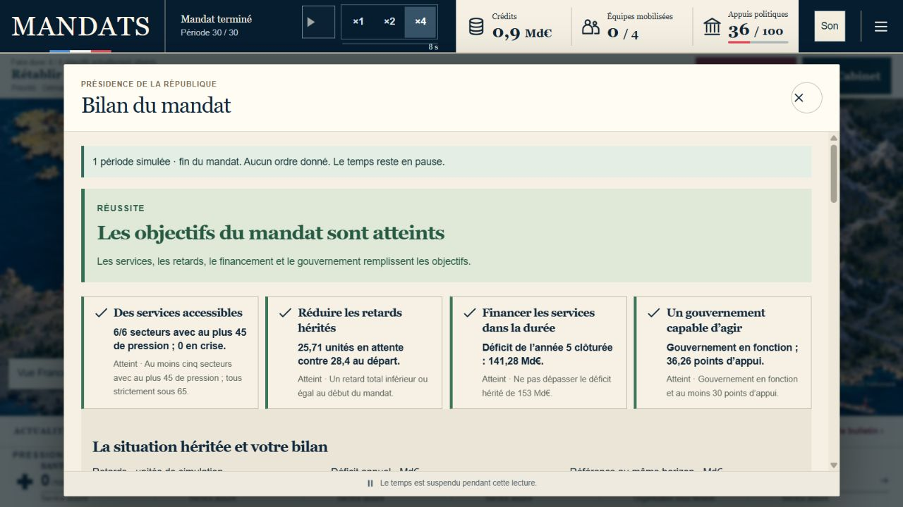
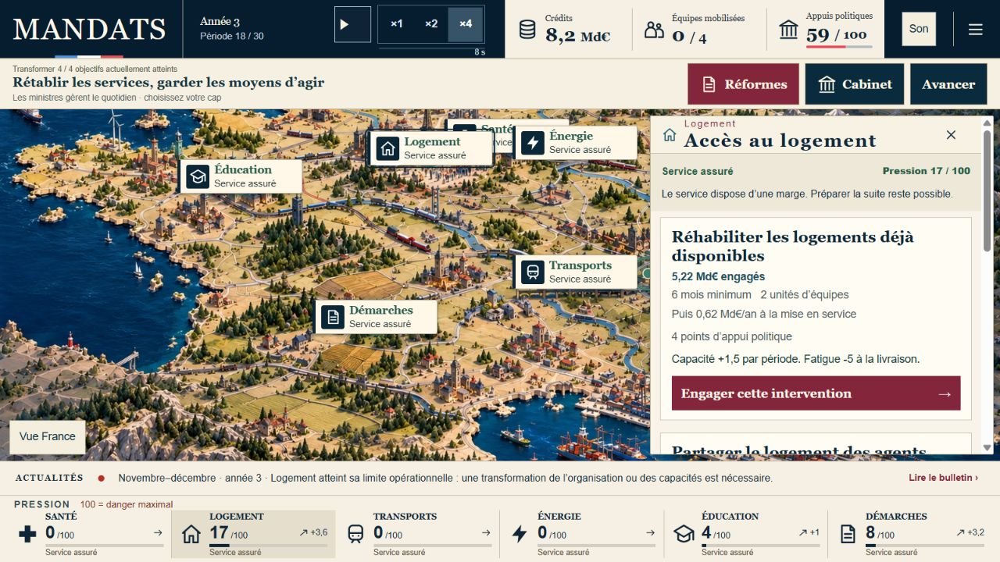
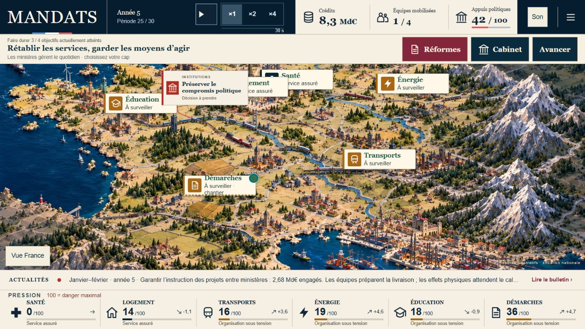

# MANDATS — essai manuel complet du 20 octobre 2026

**Verdict : partie jouable jusqu’au bilan, mais vDef non validée.** Nous terminons les cinq ans avec les quatre objectifs atteints. L’essai révèle encore des problèmes de rythme, de signaux contradictoires et de compréhension du Parlement. Une réussite du modèle ne suffit pas à valider l’expérience.

## Périmètre et méthode

- Version publiée après la [PR #215](https://github.com/supertrampsss/500SIGNATURESV2/pull/215), commit principal `ba4f28c28c69a87abee31c9e335353921eb1fe68`.
- Partie jouée sur le [déploiement immuable publié](https://e93cc708.plateforme-9sz.pages.dev/mandats/), obtenu dans le journal du déploiement réussi. Cet autre domaine permet une sauvegarde indépendante de celle du propriétaire sur `500signatures.fr`.
- Départ normal par « Commencer un mandat ». Règles v17, France, ambition équilibre, graine **612**, identifiée dans l’export après la fin de partie.
- Interface réelle dans le navigateur intégré, **1280 × 720**. Lecture des cartes, choix manuels, pause, ×1 puis ×4 et commande normale « Avancer jusqu’au prochain changement ».
- Les trois premières périodes passent pendant la prise en main et la lecture ; le premier ordre est donné en période 4. Un autre passage est observé à ×4. Les autres passages utilisent la commande Avancer. Nous ne présentons donc pas cet essai comme quinze minutes continues au chronomètre ×1.
- Aucun journal importé pour gagner, aucun état injecté, aucune horloge simulée et aucune lecture du code pour choisir une stratégie pendant la partie. L’export est produit par le bouton du bilan après les trente périodes.
- Après la fin : reprise d’un arbitrage, puis restauration par l’interface de **notre propre export terminé**, rechargement et « Reprendre ». Le même bilan réapparaît.

**Limite : essai réalisé par l’assistant déjà familier du projet, sur un seul départ et un seul format de bureau ; il ne constitue ni une étude de joueurs externes, ni une validation mobile, ni une mesure du plaisir ou de la rétention.**

## Résultat constaté

| Indicateur | Bilan affiché |
|---|---|
| Horizon | 30 périodes écoulées, mandat terminé |
| Objectifs | 4 / 4, « Réussite » |
| Retards | 28,4 au départ → **25,71** unités |
| Déficit annuel | 153 au départ → **141,28 Md€** en année 5 clôturée |
| Référence sans nouvel ordre présidentiel | 131,53 Md€ au même horizon ; notre déficit est supérieur de 9,75 Md€ |
| Appuis | **36,26 / 100**, gouvernement en fonction |
| Crédits restants | Environ **0,9 Md€** affiché |
| Pression finale | Santé 0 ; logement 5 ; transports 7 ; énergie 17 ; éducation 27 ; démarches 0 |
| Gouvernement autonome | 6 organisations courantes ; 1,04 Md€/an affiché |
| Journal exporté | 30 `live-tick`, 16 ordres dont une priorité persistante ; 46 entrées au total |

L’éducation reste « organisation sous tension » malgré l’objectif global de services atteint. Cela correspond aux seuils affichés : le bilan n’exige pas l’absence de toute tension.

## Parcours et raisonnement joueur

| Moment | Intention avant le choix | Action et résultat observé |
|---|---|---|
| Début → P4 | Comprendre les urgences héritées. | Sans ordre présidentiel, plusieurs pressions baissent déjà. À P4 : santé 30, logement 24, autres secteurs entre 2 et 6. Un objectif financier manque. |
| P4 → P6 | Renforcer durablement les soins et prévenir les ruptures de logement. | Équipes de soins : 4,98 Md€ ; prévention locative : 1,17 Md€. Deux périodes plus tard, le bulletin nomme les deux livraisons. Santé 19, logement 16. |
| P6 | Trouver une économie pour financer les nouvelles charges. | « Réduire les achats dispersés » rejeté. Aucun effet engagé. Le détail du vote, trouvé plus tard dans Institutions, indique 249 pour, 286 contre et 42 abstentions. |
| P7 → P10 | Anticiper la hausse annoncée des besoins de soins. | Réseau territorial de soins : 2,65 Md€, livraison à P10. Santé 1. |
| P10 → P18 | Attendre un besoin réel au lieu d’ajouter des ordres pour remplir le temps. | Aucun nouvel ordre présidentiel. Les ministres livrent leurs organisations. À P13, les quatre objectifs sont atteints. À P18, le bulletin annonce la limite opérationnelle du logement, alors que le secteur affiche encore « service assuré », pression 17. |
| P18 → P21 | Traiter cette limite avant la crise. | Pacte de logement des agents essentiels : 2,6 Md€, livré à P21. Les pressions du logement repartent à la baisse. |
| P19 → P22 | Répondre à l’alerte administrative et garder des appuis. | Dossiers unifiés : 1,46 Md€ ; compromis de services publics : 0,55 Md€. Les quatre équipes sont mobilisées à P21. À P22, les appuis remontent à 65. |
| P21 | Augmenter les moyens disponibles pour les autres secteurs. | Autorisation de 10 Md€ rejetée : 246 pour, 286 contre, 45 abstentions. Elle ne crée ni crédit disponible ni recette. |
| P22 → P25 | Préserver énergie et éducation avec peu de crédits. | Pilotage énergie : 1,43 Md€ ; remplacements scolaires : 1,18 Md€. Livraisons à P24 et P25. Il reste environ 0,9 Md€. |
| P25 | Comprendre pourquoi il ne reste que trois objectifs atteints. | Le panneau révèle **39,93 unités de retards**, contre 28,4 au départ. Le déficit prévu, 132,03 Md€, respecte déjà l’objectif. Le problème prioritaire est le retard, pas le déficit. |
| P25 | Obtenir des moyens pour ce rattrapage. | Nouvelle demande annuelle d’autorisation : adoptée, crédits disponibles environ 10,9 Md€. Le texte précise qu’aucune recette n’est créée. |
| P25 → P28 | Combiner réponse durable et rattrapage immédiat des démarches. | Coordination entre ministères : 2,68 Md€ ; traitement exceptionnel : 1,92 Md€ ; priorité aux démarches. Le temporaire est livré à P27, le durable à P28. Pression démarches 36 → 12. |
| P27 → P30 | Sécuriser les services essentiels avant la fin. | Réseau énergétique : 3,08 Md€, livré à P30. |
| P28 → fin | Utiliser les crédits restants contre les retards des transports. | Mobilisation exceptionnelle : 2,34 Md€, livrée à P30. Puis dernier passage de période : bilan à quatre objectifs atteints. |

## Ce qui fonctionne à conserver

1. **La préparation a un effet réel.** Le paiement n’abaisse pas immédiatement les pressions ; le bulletin permet de retrouver les livraisons nommées et datées.
2. **Les ressources font arbitrer.** En année 4, les crédits descendent, les quatre équipes sont occupées et les appuis nécessitent un compromis. La dernière année demande de choisir entre durée, urgence et coût politique.
3. **La commande Avancer évite une attente passive.** Elle s’arrête sur les événements et garde le temps en pause ; aucun ordre n’est ajouté à notre place.
4. **La fin est compréhensible et vérifiable.** Objectifs, situation héritée, référence, interventions et effets temporaires sont visibles. La réussite n’efface pas le coût de nos choix par rapport à la référence.
5. **Les outils de reprise fonctionnent sur ce parcours.** Export obtenu ; « Rejouer cet arbitrage » replace avant le rattrapage administratif à P25, avec 8,3 Md€ et 42 appuis ; notre export complet est réimporté puis repris après rechargement avec le même bilan.

## Corrections et recommandations avant l’étiquette vDef

P1 = empêche ici de valider l’expérience comme définitive. P2 = amélioration à éprouver. Les hypothèses d’équilibrage doivent être testées sur plusieurs départs avant toute modification du moteur.

| Priorité | Constat pendant l’essai | Conséquence pour le joueur | Recommandation concrète / validation attendue |
|---|---|---|---|
| **P1 — signaux d’alerte** | À P18, le bulletin dit « limite opérationnelle » au logement ; le panneau dit « service assuré » et « le service dispose d’une marge ». À P19, même problème avec les démarches. | Nous ne savons pas quel signal doit gouverner la décision. Une petite pression ne résume pas les besoins ni la fatigue. | Afficher la raison d’alerte et sa tendance dans le secteur, même si la pression reste basse. Conserver une distinction explicite entre pression, surcharge et chantier. Rejouer P18/P19 et demander au testeur de nommer le risque et l’action utile sans ouvrir plusieurs panneaux. |
| **P1 — objectif manquant caché** | P25 : « 3 / 4 » ne précise pas en vue principale que les retards sont en échec ; il faut ouvrir le long panneau des objectifs pour découvrir 39,93 contre 28,4. | La carte peut sembler rassurante alors qu’une condition de victoire se dégrade. | Remplacer le seul décompte par un court motif cliquable, par exemple « Retards : 39,93 / cible 28,4 ». Donner accès aux secteurs responsables. Le testeur doit identifier en une lecture l’objectif à redresser. |
| **P1 — collisions sur la carte** | À 1280 × 720, les repères Santé et Logement se recouvrent partiellement ; voir la capture de reprise. | Le nom Santé devient partiellement masqué et la lecture du pays perd sa clarté. | Adapter l’ancrage ou la disposition des étiquettes aux formats intermédiaires. Vérifier six noms et six zones de clic visibles sans chevauchement à 1280 × 720 et aux formats voisins. |
| **P1 — vote peu prévisible** | L’économie est rejetée ; l’autorisation est rejetée en année 4 puis adoptée en année 5. Le premier résultat détaillé est trouvé plus tard dans Institutions. | Nous pouvons constater le résultat sans comprendre comment préparer le prochain vote. Aucun lien clair n’a été perçu entre nos actions et ce changement de résultat. | Avant le vote, montrer les soutiens connus et les conditions du compromis sans inventer une probabilité. Après le vote, afficher immédiatement la répartition et les facteurs calculés utiles. Le testeur doit pouvoir expliquer le rejet et une prochaine option ; ne pas lui promettre un vote garanti. |
| **P2 — rythme d’ouverture** | Quatre objectifs sont déjà atteints au départ ; après trois transformations et un vote rejeté, aucun nouvel ordre présidentiel entre P10 et P18. Les pressions restent très basses pendant une grande partie du début. | Sur ce parcours, nous attendons surtout une nouvelle raison d’agir. La tension et les arbitrages arrivent tard. | Clarifier dès l’entrée ce qui doit être maintenu et les besoins à venir ; proposer un cap initial concret. Éprouver ensuite la répartition des besoins et événements sur plusieurs départs, sans ajouter un quota de clics ni accélérer artificiellement la crise. |
| **P2 — causalité vécue** | Les livraisons sont nommées mais leur formule reste souvent générique : capacités, besoins ou appuis « changent réellement ». Le compteur d’équipes reste à 0 juste après un engagement puis affiche la mobilisation au passage de période. | Le changement de fonctionnement est vérifiable, mais la préparation et son bénéfice restent abstraits à la première lecture. | Montrer un avant/après court avec les valeurs réellement calculées et « équipes prévues / mobilisées ». Relier la pression observée aux autres facteurs sans attribuer toute variation à notre décision. |
| **P2 — densité législative** | Le panneau Réformes contient une longue liste de questions ; le texte accessible de plusieurs options répète trois fois la même contrepartie. Après la fin, les questions législatives disparaissent du panneau pourtant annoncé consultable. | Chercher une mesure financière demande beaucoup de lecture ; le bilan ne donne pas accès au même catalogue. | Regrouper les questions par enjeu, afficher chaque contrepartie une seule fois et clarifier la consultation après mandat. La répétition a été relevée dans l’arbre accessible ; une capture ciblée pendant un prochain mandat doit confirmer sa présentation visuelle exacte. |

## Suite de recette recommandée

1. Corriger d’abord les quatre P1 d’interface et de compréhension, avec cas de reproduction issus de ce journal. Préserver les règles et sauvegardes v17.
2. Faire rejouer ce départ et un départ différent à des personnes qui ne connaissent pas le projet. Observer le premier ordre, l’identification d’une alerte, le financement, la compréhension d’un rejet et l’explication du bilan.
3. Conduire une partie complète sur téléphone, puis les contrôles ciblés clavier, mouvement réduit, reprise et hors connexion. Les anciens tests automatisés restent utiles mais ne remplacent pas cette recette.
4. Réévaluer le rythme seulement après ces observations. Aucun taux de plaisir, de rétention ou de difficulté n’est déduit de notre unique réussite.

## Pièces conservées

- [Export exact de la partie terminée](partie-jouee-v17.json) — JSON créé par le jeu, non retouché.
- [Bilan avant toute reprise/import](bilan.ax.txt).
- [État à l’entrée de l’année 3](annee3.ax.txt).
- [Première livraison observée](premiere-livraison.ax.txt).
- [Capture du bulletin de livraison](01-premiere-livraison.png).
- [Capture de l’alerte logement](02-alerte-logement.png).
- [Capture du bilan original](03-bilan.png).
- [Capture de la reprise avant l’arbitrage](04-reprise-arbitrage.png).

Les fichiers texte sont des relevés d’accessibilité bruts ; leurs rôles techniques peuvent différer des libellés DOM. Aucun correctif applicatif ni nouvel équilibrage n’a été livré pendant cet essai. La reprise d’arbitrage a été vérifiée jusqu’au point de reprise, sans prétendre avoir achevé une seconde trajectoire.
