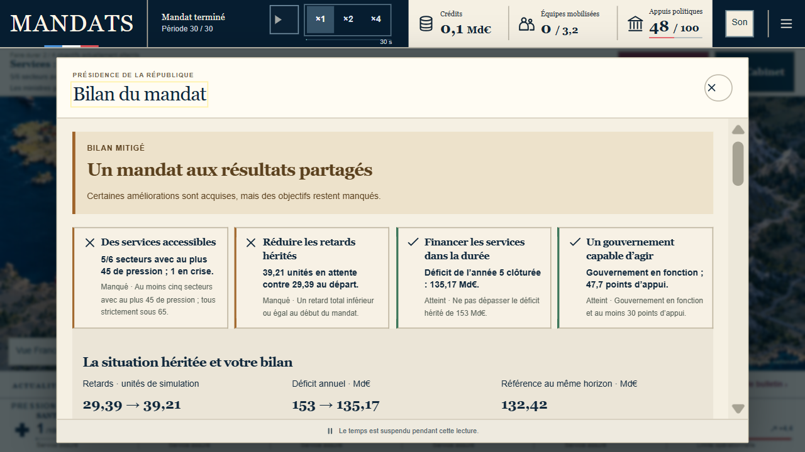
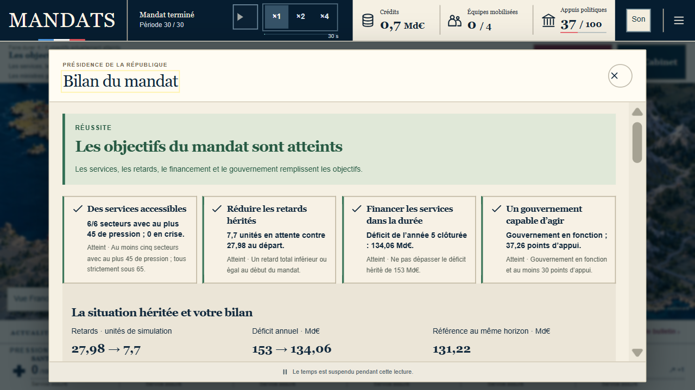

# MANDATS — recette clavier du 21 octobre 2026

**Ce dossier conserve les preuves de reproduction et les validations avant publication.** Les statuts intermédiaires ci-dessous datent de leur collecte ; la [PR218](https://github.com/supertrampsss/500SIGNATURESV2/pull/218) consigne l’état de la livraison et des vérifications publiques.

## Partie qui a révélé le défaut

La partie v17, graine 1, a été jouée intégralement à ×1 réel avec pauses sur main `28a41096`, à l’adresse immuable c5e54344. Aucun import, commande Avancer ou temps injecté. Un rechargement en première période, après deux ordres, a remis le compteur partiel à zéro sans modifier le journal ; les notes opérateur consignent environ 26 secondes actives supplémentaires.

Le [journal joué](partie-publiee-x1-main28.json) contient **30 périodes autonomes et 18 ordres**. Sa reconstruction indépendante valide les 49 préfixes, journal vide compris. Le bilan est de **2/4** : financement et gouvernement atteints ; services et retards manqués. Retards : 39,21, cible 29,39. Déficit : 135,17 Md€, plafond 153 ; référence autonome : 132,42. Appuis : 47,7. Démarches finit à 98,01/100 et 36,82 unités en attente. Ces chiffres appartiennent à la simulation ; une défaite n’est pas masquée par la recette.

À la fin automatique, le bilan porte `role=dialog` et `aria-modal=true`, mais le focus reste sur le rail Santé. Une vraie Tab le déplace vers Logement derrière la fenêtre. Preuves : [focus initial](focus-avant-main28.json), [focus après Tab](tab-avant-main28.json).

Ces preuves concernent les fichiers `mandats-TSeUnPH4.js` / `mandats-HazkIm3P.css`, source `2d65550c` incluse dans main28. Elles ne valident pas le correctif ultérieur.

## Correction en cours de validation

Les reproductions avant correction établissent quatre problèmes : la restauration du secteur écrase le focus initial du bilan ; Réformes inclut des commandes masquées dans des dossiers fermés ; Tab ne récupère pas un focus déjà placé derrière la fenêtre ; Escape n’a pas de destination utilisable lorsque l’origine est le fond de carte ou un bouton devenu désactivé.

Le changement est limité au runtime de présidence et à ses tests navigateur. Le bilan doit conserver son titre focalisé, les fenêtres doivent confiner Tab/Shift+Tab aux commandes visibles et Escape doit retrouver une commande utilisable. Le repli de visibilité doit aussi fonctionner sans l’API récente `checkVisibility`.

Les règles, tirages, comptes, délais de jeu et formats de sauvegarde restent identiques. Les résultats après correction, empreintes et captures seront ajoutés seulement après leur vérification.

## Méthode et limites

Les tests automatisés utilisent des journaux légaux et une horloge contrôlée ; ils sont distingués des parties jouées au temps réel. Un effet de défilement provoqué par le ciblage sémantique CUA a été isolé par comparaison avec le pointeur et le vrai clavier ; aucun correctif applicatif de défilement n’est attribué à cet effet.

Cette recette cible transfert de focus, Tab/Shift+Tab et Escape, selon le [modèle de fenêtre modale W3C APG](https://www.w3.org/WAI/ARIA/apg/patterns/dialog-modal/). Elle ne certifie pas une conformité WCAG globale. Les parties sont jouées par un assistant familier du produit sur navigateur et formats émulés, sans étude de joueurs externes, NVDA/VoiceOver ni appareil physique.

## Recette ciblée au vrai clavier, après correction

Sur une origine locale neuve, le build `mandats-_ZrXR1o6.js` est contrôlé dans le DOM. Le journal de la partie réelle est importé par le menu normal avec seulement son dernier `live-tick` retiré : 29 périodes et 18 ordres. La dernière période s’écoule au temps réel ×1 après navigation par Tab jusqu’au rail Santé. Cette reprise ciblée n’est pas présentée comme un nouveau mandat complet.

À P30, [le titre du bilan conserve le focus](focus-apres-local.json). [Le vrai clavier](clavier-apres-local.json) parcourt Fermer → Exporter avec Shift+Tab → Fermer avec Tab ; Escape retrouve le rail Santé. L’export normal est strictement identique au journal complet d’origine : 30 périodes, 18 ordres, mêmes entrées. Après rechargement et reprise au clavier en format mobile, mêmes chiffres et même bilan 2/4 ; aucune erreur ni alerte console relevée.

Les captures proviennent du navigateur, sans retouche. Un clic de ciblage après émulation mobile n’activait pas Reprendre ; la reprise par le vrai clavier fonctionne. Aucun défaut applicatif ni patch de pointeur n’est attribué à cet effet. L’ancienne origine locale contenant une partie historique n’a reçu aucun import ; la recette utilise une origine neuve. La sauvegarde canonique du propriétaire reste intacte.

## Validation du build identifié

Source applicative : `a703d864412e89f07c2ce429557a590df6c25aee`. Le [manifeste du build](build-evidence.json) enregistre JS `mandats-_ZrXR1o6.js` et CSS `mandats-HazkIm3P.css` ; l’ancien manifeste source2d est conservé séparément.

- `npm run check` : sortie 0, **1 158 tests unitaires réussis, aucun échec**, types application/scripts/functions, build, pré-rendu et bundle hors connexion. Celui-ci contient 37 ressources, version `f3a6c91463ff3983`.
- **32/32 contrôles ciblés sans retry** : 24 cas clavier et API absente sur bureau 1672×941, compact 320×568 et WebKit 390×844 ; 4 reçus/lecture Cabinet existants ; 4 premières ouvertures v16 existantes.
- Revues indépendantes de conformité et de qualité : Approved après correction du finding Safari. L’appel natif n’est exécuté que si disponible ; le repli exclut commandes masquées, contenu de détails fermés et ancêtres masqués.
- Les rouges précèdent les corrections : focus automatique, détails fermés, récupération de focus et origines Escape inutilisables. Sans API, Réformes reproduit le rouge ; Escape v16 reproduit un TypeError sur un journal légal terminé à P27. Une première fixture v16 invalide échouait avant montage et n’est pas comptée comme preuve Escape.

Les logs détaillés locaux restent dans `.superpowers/sdd/modal-safari-*.log` et `site/vdef-artifacts/player-modal-check.log`. Le retrait de l’API sur les moteurs récents exerce le repli ; il ne constitue pas un essai de Safari 16 physique. La suite vDef, les contrôles distants et la publication restent à terminer à ce stade de recette.

## Mandat neuf entier, build corrigé local

La source a703 est ensuite jouée sur une origine neuve, au vrai ×1 avec pauses de lecture : aucun import, commande Avancer ou temps injecté. Le [journal normal exporté](partie-neuve-locale-x1.json) confirme v17, graine0,30 périodes autonomes et14ordres ; reconstruction indépendante des45préfixes valide. **4/4objectifs** : sixsecteurs sous45, aucun encrise ; retards7,7/cible27,98 ; déficit annuel clôturé134,06Md€/plafond153 ; gouvernement enfonction,37,26appuis. La référence autonome est131,22Md€, écart global+2,84 dans la simulation.

[Au vrai clavier](clavier-partie-neuve-locale.json), le titre garde le focus à la fin automatique avant tout ciblage. Tab et Shift+Tab restent dans le bilan ; Escape revient au railSanté. [Après préparation horsconnexion par le menu](offline-partie-neuve-locale.json), le réseau est coupé pour cet onglet, la page rechargée et Reprendre activé : même texte de bilan, même bundle ; le second export est identique octet pour octet. Réseau rétabli et reprise mobile inspectée ; console avertissement/erreur vide.

La suite vDef termine **155/155 sans retry**, cinq formats,16,4min. Cette partie valide le build local identifié, et ne constitue pas une preuve de sa publication.

## Diagnostic des contrôles généraux

Le premier run local général termine257passes,10échecs,73exclusions prévues ; sa CI f329 termine265passes,1échec final et1succès après retry. Les artefacts sont conservés. Parmi les constats : courses de lecture d'un reçu éphémère, budgets globaux dépassés et latences de création/fermeture de contexte dont la cause interne reste inconnue.

Un recontrôle de9parcours desktop, mêmes budgets, unworker et traces actives, donne6passes/3échecs. France13 passe toutes ses assertions, puis dépasse60s à la fermeture du contexte ; la campagnev9 dépasse120s malgré une continuation produisant sonPNG en0,26s. Les étapes après borne ne sont pas comptées comme succès.

Le contraste suivant conserve exactement les deux tests France13 et campagnev9, unworker, zéroretry, mêmes budgets/assertions ; seule la trace est désactivée. Il termine **2/2 en1,9min**, fermetures comprises. Il étaye le coût possible de l'instrumentation sur ces parcours, sans établir la cause générale des latences. Le mode de trace de la suite générale devient on-first-retry : rapport et captures restent disponibles, premier retryCI tracé, diagnostic local avec --trace on. Les budgets, retries, workers, exclusions et assertions sont conservés. Ce choix suit les [conseils officiels Playwright](https://playwright.dev/docs/best-practices).

Le contrôle des reçus doit observer leur visibilité et leur texte dans une seule lecture navigateur, avant le décodage coûteux de la sauvegarde. Sa validation ciblée et la nouvelle suite complète restent à terminer ; aucun succès anticipé ni contournement de protection de branche.

### Vérification ciblée du harnais

Deux copies diagnostiques du même fichier sont exécutées avec une latence publique côté client de2 200ms, sans modifier le jeu : l'ancien ordre échoue deux fois aux attentes attendues (visibilité après lecture de sauvegarde, puis texte relu après expiration) ; le nouvel ordre passe **2/2 en18,6s**. Le texte de reçu observé est conservé et le journal exact reste vérifié. Les fichiers, logs rouges et verts sont conservés dans .superpowers/sdd/modal-story-race-* ; ils constituent des diagnostics, pas des cas supplémentaires revendiqués dans la suite standard.

Les deux parcours standards ciblés (autoclose et délai de retour clavier existant), sur les fichiers définitifs et budgets d'origine, terminent **2/2 en18,0s**, sans retry. Les revues statiques de conformité et de qualité n'identifient aucun finding bloquant. Nouvelle suite complète et CI requises avant fusion.

## Fiabilisation complémentaire des contrôles

La tête34cbc conserve son propre résultat : générale locale265passes,2échecs,73exclusions prévues ; CI générale verte avec266passes et1succès après retry sur la navigation éditoriale. Les deux échecs locaux sont l'import (timeoutglobal60s non localisé) et un test du votev10 qui attend Continueenabled.

Le helperv10 cherchait l'ancienne action skip alors que le runtime rend show-result. Une régression dédiée gèle l'horloge, avance seulement de111ms pour la transition de décision et reproduit l'attente échouée. Le helper corrigé utilise le vrai raccourci ; les horloges des parcours originaux restent réelles. Il vérifie les577sièges, chaque total affiché, le vote restauré et l'identité brute de la sauvegarde avant/après révélation, poursuite et rechargement. Le premier contrôle avec tracesactives/deuxworkers donne1passe et2échecs (corps de la régression entièrement réussi puis teardown60s ; autre corps dépassant60s avant reload), conservés sans les appeler verts. Les mêmes trois cas terminent ensuite **3/3 en23,3s**, unworker, trace désactivée, budgets identiques.

Le timeout d'import est instrumenté sans modification applicative : même scénario, mauvaises puis bonne sauvegarde, reprise, chaque phase et fermeture repérées. Deux cas séquentiels passent en14,2/16,2s (total33,7s) ; deux cas parallèles passent en26,3/25,6s (total28,7s), sans erreur relevée. Le timeout initial n'est pas reproduit ni attribué à une étape. Ce contraste ne reproduit pas toute la charge de la générale.

La suite générale est désormais limitée à **unworker**, plusieurs parcours ouvrant déjà un second contexte isolé. Ce choix de capacité privilégie les durées individuelles et la reproductibilité ; il n'établit pas une cause unique aux latences inconnues. Les budgets, assertions, projets, retries et exclusions restent conservés ; traces au premier retryCI. Il suit les [recommandations CI officielles Playwright](https://playwright.dev/docs/ci). Une nouvelle suite complète sur ce réglage reste nécessaire.

La course éditoriale concerne un lien encore absent du header lors de son hydratation : avant de décider si le menu mobile doit être ouvert, le test attend maintenant l'attachement du lien. La reproduction retardant seulement le chargement du module principal est détaillée ci-dessous.

La reproduction éditoriale retardant seulement le module principal confirme le défaut du test : ancienne condition, attente du menu desktop caché et échec60s ; nouvelle attente d'attachement, **1/1 en6,0s**. Ce mécanisme reproduit isolément une course possible, sans établir la chronologie exacte du primaireCI non tracé. Le parcours original complet de métadonnées passe ensuite **5/5 formats en15,5s**, unworker, zéroretry et trace désactivée. Les deux préflights sans test (résolution d'import, filtre de titre trop strict) sont conservés et ne sont pas des rouges fonctionnels.

Les nouvelles validations globales sur le dernier commit restent distinctes de ces contrôles ciblés. Le statut exact, les liens deCI, la fusion protégée et la recette publiée sont consignés dans la PR de livraison.
