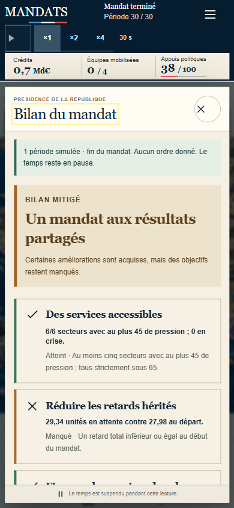
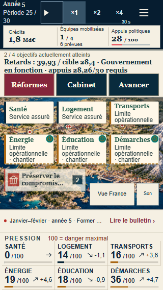
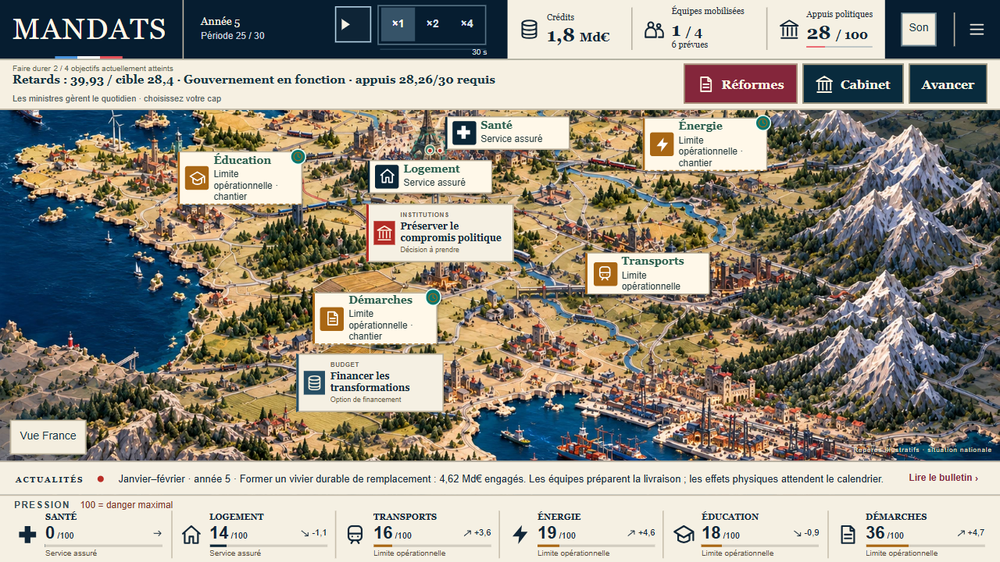
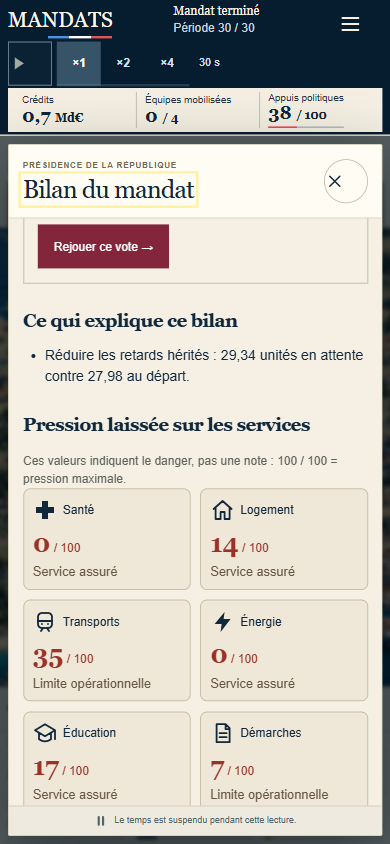
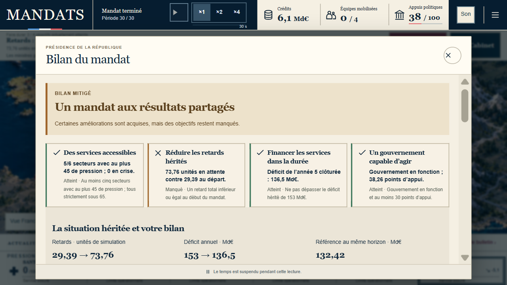
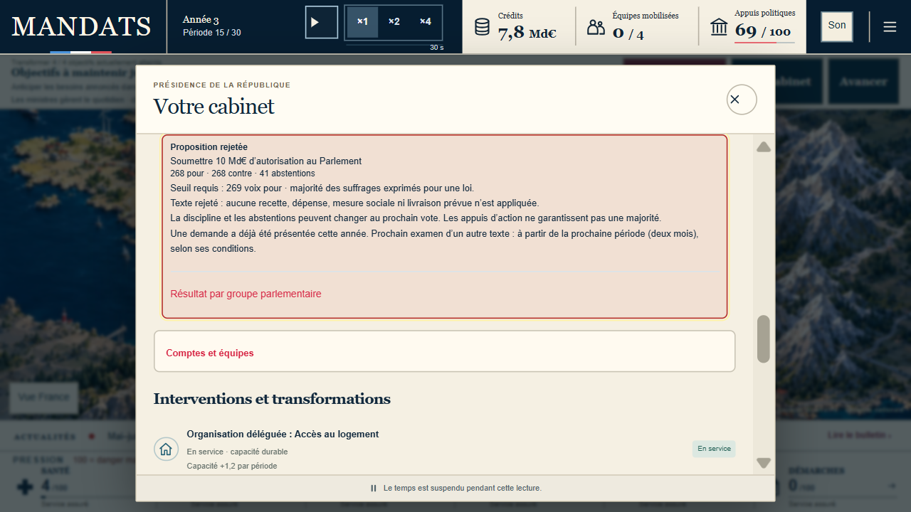
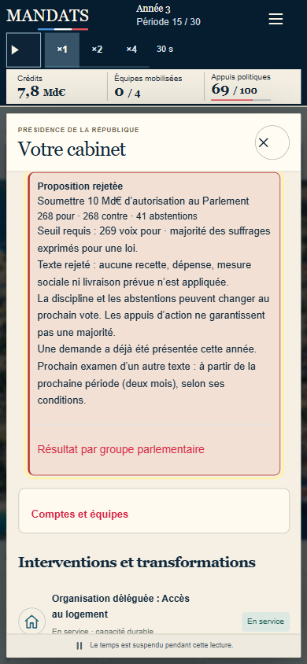

# MANDATS — corrections et nouvelle recette joueur

**Mandat neuf joué jusqu’au bilan sur mobile : 3 objectifs sur 4, bilan mitigé.** Les retards restants sont explicitement désignés ; aucun blocage n’a empêché les trente périodes, l’export ou la reprise. Le contrôle local complet passe ; la revue et les gates de livraison font l’objet d’un suivi distinct dans la PR.

## Ce que nous avons réellement joué

- Départ normal « Une coalition fragile », sans import, sur une origine locale réservée à cet essai : `http://127.0.0.1:4182/mandats/`. La sauvegarde du propriétaire sur le domaine public est conservée.
- Règles v17, ambition équilibre, **graine 0**, identifiée seulement dans l’export final. Le [journal réellement exporté](partie-mobile-jouee.json) contient **30 passages de période et 14 ordres**, soit 44 entrées.
- Navigateur intégré, écran CSS **390 × 844**. Les six premiers passages ont lieu à ×1, avec environ trois minutes de temps actif et des pauses de lecture supplémentaires. Les 24 autres passages utilisent la commande normale Avancer. Aucune horloge, aucun état ni journal de victoire injecté.
- Stratégie choisie depuis les informations visibles : organisation et prévention d’abord, réseaux durables ensuite, rattrapage administratif en fin de mandat. Aucun ajustement du moteur pour faire réussir cette trajectoire.
- La partie commence sur `mandats-hkKKILPW.js`. Une correction de singulier du groupe d’événements produit `mandats-D0JMRBSv.js` ; rechargement normal à P21, neuf ordres retrouvés, mêmes crédits et appuis. La logique du jeu ne change pas entre ces rendus. Le dernier alignement des libellés du bilan, `mandats-DmGVFSHv.js`, est vérifié séparément sur cette sauvegarde terminée : transports et démarches affichent bien leur limite opérationnelle.

**Limite : essai par l’assistant déjà familier du projet, sur téléphone émulé ; aucune étude de joueurs externes, mesure du plaisir ou validation sur appareil physique n’est revendiquée.**

## Résultat constaté

| Indicateur | Bilan affiché |
|---|---|
| Fin | 30 périodes, mandat terminé |
| Objectifs | 3 / 4, « Un mandat aux résultats partagés » |
| Retards | 27,98 → **29,34** unités ; objectif manqué |
| Déficit annuel | 153 → **129,22 Md€**, année 5 clôturée |
| Référence au même horizon | **131,22 Md€** ; écart −2 Md€, comparaison globale avec gouvernement autonome |
| Appuis | **38,26 / 100**, gouvernement en fonction |
| Crédits restants | Environ **0,7 Md€** affiché |
| Pression finale | Santé 0 ; logement 14 ; transports 35 ; énergie 0 ; éducation 17 ; démarches 7 |

Les chiffres décrivent cette simulation. Le bilan distingue les services accessibles du retard total ; il ne transforme pas les trois objectifs atteints en victoire complète.

## Décisions et conséquences observées

| Moment | Intention puis résultat |
|---|---|
| P1 | Prévenir les ruptures locatives (1,17 Md€), organiser les parcours de soins (1,4 Md€). Crédits et appuis diminuent immédiatement ; les pressions restent inchangées avant livraison. Deux travaux prévus sont distingués des équipes déjà mobilisées. |
| P2–P4 | Les premières livraisons apparaissent avec leur origine ministérielle ou présidentielle. Le bulletin suspend le temps ; sa fermeture garde la pause et la reprise conserve les secondes restantes. |
| P6 | Financer la durée par « Fermer les outils redondants », −3 Md€/an avec perturbation des équipes. Loi adoptée **287 pour, 247 contre, 43 abstentions**, seuil 268. Le résultat remonte dans Réformes ; sa répartition par groupe s’ouvre immédiatement. |
| P7–P10 | Anticiper les besoins de soins annoncés : réseau territorial, 2,65 Md€. Livraison à P10, **capacité +2,2 et besoins −0,3 par période** inscrits au bulletin. |
| P13–P18 | Attendre un besoin réel. À P18, logement pression 15 : la carte, le panneau et le bulletin annoncent tous la limite opérationnelle. Aucun texte ne prétend que le ministère dispose encore d’une marge. |
| P18–P21 | Partage du logement des agents, compromis de services publics, pilotage énergétique. Quatre équipes réellement mobilisées, travail prévu affiché séparément. Le compromis ne fournit ses appuis qu’après livraison. |
| P21 | Dossiers unifiés et réseau énergétique. Demande annuelle de crédits rejetée **250/284/43**, seuil 268 ; aucune enveloppe créée. Le résultat et son détail restent dans le contexte de financement. |
| P21–P23 | Préparer les remplacements scolaires : les appuis passent à 28,26, seuil 30 clairement visible. Après livraison, ils remontent ; le bandeau désigne alors les retards comme nouvel objectif manquant. |
| P25 | Nouvelle demande annuelle rejetée **248/283/46**, seuil 266. Réaffectation de 1,2 Md€ d’investissement général, avec actifs −1 annoncé et aucune recette créée. |
| P25–P30 | Renfort administratif de huit mois, 1,92 Md€, après lecture de son caractère temporaire. Le retard baisse mais reste supérieur au départ après le dernier passage : bilan mitigé assumé, sans modifier les règles. |
| Après fin | Export par le bouton du bilan, consultation des réformes désactivées, puis rechargement et Reprendre : mêmes retards, déficit, appuis et bilan. Rejouer le vote ramène à P6 avant son adoption ; réimportation de notre propre export terminé : mêmes trente périodes et même bilan. |

## Défauts corrigés et contrôles

| Défaut | Contrôle concret |
|---|---|
| Ministère limité présenté comme rassurant | Préfixes du journal original 612 ; nouveau logement P18, énergie P19 et démarches P21. Retour au service opérationnel observé après transformation suffisante. |
| Libellé du bilan différent de la carte | Même modèle de lecture v17 pour les secteurs de la carte, du panneau et du bilan ; vérification réelle sur transports et démarches après rechargement de la partie terminée. |
| Objectif manquant caché derrière un compteur | Deux objectifs simultanés visibles à 320 et 390 pixels ; nature, valeur et cible ; liens directs vers les secteurs responsables des retards. |
| Trois objectifs qui débordent du bandeau | Cas légal graine612 : quatre organisations, capacités de soins et de logement puis un passage. Retards30,04/28,4 ; déficit166,1/153 ; appuis26,26/30. Hauteur naturelle du bandeau et zones de carte mesurées ; les trois valeurs restent visibles à320,390,844,1024,1280 et1672 pixels. Tab puis Enter permettent réellement d’activer la priorité Énergie à320. |
| Secteurs qui se recouvrent ou texte rogné | Rectangles mesurés et hauteur adaptée au contenu ; contrôle de cinq dimensions, panneau ouvert et fermé, événements groupés. Les captures `controle-*` conservent les défauts intermédiaires, les images numérotées montrent le rendu corrigé. |
| Résultat de vote éloigné de la décision | Nouveau vote informatique adopté dans Réformes, deux crédits rejetés depuis la carte ; budget adopté qui résout l’événement reproduit séparément par le parent depuis le préfixe du journal original :308/227/42, crédits0,94→10,94, reçu conservé et groupes ouverts. Ce cas reconstruit ne compte pas comme une nouvelle partie complète. |
| Régression des anciennes parties v16 | Régression de rendu du panneau Réformes et parcours navigateur dédiés. |
| Coûts nuls inventés dans le catalogue terminé | Pension/aide à domicile en consultation : **2 Md€, quatre mois, une équipe**, boutons désactivés. |
| Mauvais exercice financier dans le cap | Cas de frontière annuelle comparé à l’objectif autoritatif ; aucune valeur du moteur modifiée. |
| Capture automatisée qui relance le temps | Horloge figée et capture sans pause/reprise du pays ; temps, minuterie et sauvegarde contrôlés. Les exécutions initiales interrompues restent des échecs, pas des passes. |

Le contrôle à trois objectifs et les captures16,17 et22 à25 utilisent le rendu `mandats-_eZnpf9-.js`, postérieur à la partie complète. Aucun état légal à quatre objectifs simultanément manqués n’a été obtenu pour cette recette ; aucune donnée n’a été inventée pour le simuler. La hauteur ne dépend pas d’un nombre prédéfini d’objectifs.

## Validation et livraison

Révision applicative finale de cette recette : `2d65550ccda694b30798d3a633c780fd3fa878c8`.

- `npm run check` exécuté par le parent sur cette révision : **1 158 / 1 158 tests unitaires**, zéro échec ; types, build, pré-rendu et génération hors connexion réussis. Bundle offline :37 ressources, version `b4e9f43400393264`.
- Régressions ciblées de l’implémenteur : 22 / 22 ; ouvertures et captures 6 / 6 dans chacune des deux suites ; parcours budget/contenu finaux 4 / 4 dans Chromium et WebKit. Ces contrôles ciblés ne sont pas présentés comme les suites navigateur complètes.
- Après correction du bandeau :8 / 8 tests ciblés dans Chromium/WebKit, couvrant les six dimensions, ouvertures/fermetures, contenu des repères, collisions et budget adopté. La suite vDef complète du parent sur `79bba5e3` termine avec **145 / 145**, en 15,2 minutes. Elle précède les trois derniers changements de copie et de focus. Le parent vérifie ensuite **8 / 8** régressions Cabinet/Réformes/budget adopté sur le dist final `2d65550c`, Chromium et WebKit. Pour éviter la saturation locale, les autres suites générales et la nouvelle suite vDef complète sont exécutées par les gates CI de la même tête ; leurs résultats sont consignés dans la PR.
- Les premières suites globales interrompues après erreur du harnais sont conservées comme échecs. Les suites globales corrigées, la revue indépendante, les gates CI, la fusion et le contrôle du domaine publié sont consignés dans le compte rendu de livraison de la PR associée à cette révision.

Le [manifeste des bundles](build-evidence.json) est produit après le contrôle complet, avec empreintes SHA-256 et commit. La publication doit servir ces mêmes fichiers et être essayée dans le navigateur. Un build réussi ne vaut ni essai joueur ni publication réussie.

## Mandat supplémentaire entièrement au temps réel

Un départ neuf « Des services à préserver » (ancien libellé « Un hôpital à sauver »), origine réservée `4183`, bureau CSS1280×720, est joué jusqu'au bilan à **×1 exclusivement** : aucun Avancer, import, journal préfabriqué ou temps injecté. Les trente passages autonomes représentent quinze minutes actives au rythme du jeu, avec des pauses de lecture supplémentaires. Le [journal exporté](partie-bureau-reel-x1.json) confirme la graine1, les **30 passages et 11 ordres**. La partie entière utilise `mandats-_eZnpf9-.js` ; seul le contrôle de reprise après la fin utilise le nouveau `mandats-TSeUnPH4.js`. Ces preuves ne sont pas présentées comme une partie entièrement jouée sur le dernier build.

Deux capacités logement/démarches sont financées P4, puis les organisations santé P16, éducation P18 et énergie P19, le réseau de soins P20. Le financement est rejeté P15 (**268/268/41**, seuil269), rejeté P22 (**224/305/48**, seuil265), puis adopté P26 (**279/249/49**, seuil265), avec exactement10 Md€ d'autorisation supplémentaire et aucune recette créée. Le réseau énergétique et le rattrapage administratif sont engagés P26 et livrés avant le bilan. Aucun seuil ni résultat n'a été modifié pour cette trajectoire.

Bilan réellement obtenu : **3 / 4**, retards **73,76 / cible29,39**, déficit annuel **136,5 Md€** (référence132,42), appuis **38,26** ; pressions0/43/43/36/53/8. Export puis rechargement/Reprendre : mêmes valeurs et même bilan ; aucune erreur/warning console relevée dans cet essai.

## Focus du nouveau vote Cabinet et contrôle des captures

Le nouveau vote Cabinet déplace désormais le focus clavier sur son reçu et aligne son début ; un ancien vote ne recentre pas la lecture lors d'un autre ordre. Régression rouge sur le focus avant correction, puis verte sur le dist final. Le préfixe P15 de la partie réellement jouée est réimporté séparément pour vérifier ce parcours sur bureau et mobile : résultat, seuil, absence d'effet du rejet et détail par groupe restent accessibles.

Le déplacement supplémentaire du panneau observé pendant cette recette a été isolé dans notre outil de capture : sous le zoom0,5 du navigateur intégré, `captureBeyondViewport:true` modifie le défilement du panneau. Avant capture, le reçu est visible ; une capture sans agrandissement de surface (`false`, cadrage identique) conserve exactement sa position et son focus. Aucun correctif spéculatif du moteur ou du défilement du jeu n'a été ajouté pour masquer cet effet de l'outil. Le contrôle mobile au zoom1 reste également stable avant et après capture.

